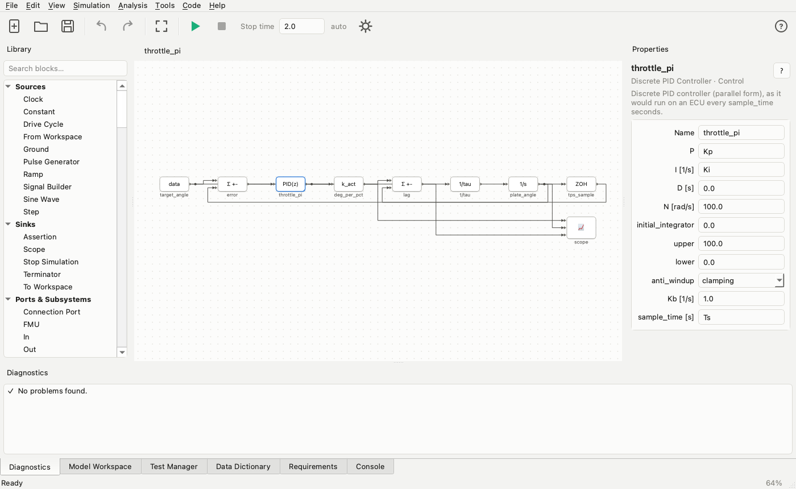
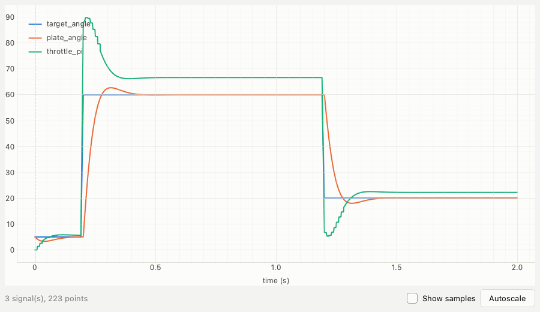

# Nervus

**Open-source block-diagram modeling and simulation in Python — an alternative to Simulink.**

*Nervus* is Latin for *nerve*. An engine control unit (ECU) is a vehicle's nervous system, and Nervus aims to be a
tool for designing, simulating and eventually generating C code for that kind of control software.



> **Status: pre-alpha.** The simulation engine and core blocks are under active development. See
> [`plan.md`](plan.md) for the roadmap.

## Goals

- A **headless simulation engine** in pure Python (NumPy/SciPy) that can be scripted, tested and run in CI.
- A **clean, modern desktop editor** built with PySide6 (Qt), using a Model–View–Controller architecture.
- A **block library** for control engineering, with automotive blocks such as engine and vehicle dynamics models,
  lookup tables and state machines.
- **C code generation** for embedded targets (ECUs), verified against the Python simulation (working:
  see below).
- **Git-friendly model files**: plain JSON that can be diffed and reviewed.

## What Nervus can do

| Area | Features | Guide |
|---|---|---|
| Editor | block library with search, drag and drop, wires that route around blocks, undo, copy/paste, subsystems, flip/rotate/resize, auto layout, light and dark theme, F1 help with equations for every block, a Python **console** with the model in scope, **Simulink `.slx` import** | [Editor](docs/editor.md) |
| Simulation | continuous, discrete and multirate models; fixed-step and variable-step solvers (also stiff: BDF); zero-crossing detection; an algebraic loop solver; real-time pacing; live scopes | [Concepts](docs/concepts.md) |
| Parameters and data | model workspace with units, limits and data types; expressions; calibration sets (`.nervcal`); a **data dictionary** of signal objects (type, unit, range) bound to named wires | [Workspace](docs/workspace.md) |
| Structure | subsystems, masks, enabled/triggered/function-call subsystems, atomic ECU tasks with their own period, variants, linked component libraries | [Subsystems](docs/subsystems.md), [Libraries](docs/libraries.md) |
| Logic | State Chart block with a **graphical chart editor**: nested and parallel states, history, events, guards, timers, calibration parameters | [State machines](docs/statecharts.md) |
| Physical modelling | electrical, rotational, thermal and hydraulic networks connected like real parts; batteries, motors, solenoids, injectors, relays, alternator, glow plugs, NTC thermistors | [Physical modelling](docs/physical.md) |
| Electronics | LTspice-style circuit simulation: diodes, BJTs, MOSFETs, op-amps, switches; operating point and DC sweeps; SPICE netlist import and export | [Physical modelling](docs/physical.md), [Circuits tutorial](docs/tutorials/circuits.md) |
| Automotive models | mean-value engine, vehicle and driveline, tyres (magic formula), automatic and automated gearboxes, sensor and actuator models, diagnostic monitors with DTCs, adaptive maps, the official **WLTC and FTP-75 drive cycles** | [Tutorials](docs/tutorials/index.md) |
| ECU code | C code generation (multirate, calibratable parameters, A2L file, HTML report), fixed-point data types, integer-only code for processors without an FPU, software-in-the-loop check, reusable functions for subsystems, MISRA C:2012 check (cppcheck), **FMI 2.0 FMU export and import** | [C code](docs/codegen.md), [Data types](docs/datatypes.md) |
| Vehicle networks | CAN Pack/Unpack with DBC files (also **CAN FD**, multiplexed signals, value tables); **simulated CAN buses** with arbitration, bus load, gateways, rest-bus simulation, fault injection and E2E protection; bus trace with ASC/BLF export; real CAN adapters through python-can | [CAN](docs/can.md) |
| Measurement and calibration | **XCP on CAN**: calibrate a running model from INCA/CANape or Python, or a real ECU from Python; **MDF4** (`.mf4`) import and export | [CAN: XCP](docs/can.md#xcp-live-measurement-and-calibration), [Testing](docs/testing.md) |
| OBD-II | live data and trouble codes from a real car (ELM327 or CAN), and a simulated ECU to practise with | [OBD-II](docs/obd.md) |
| Testing | test cases stored with the model, **Signal Builder** (test signals drawn in an editor), Test Manager, Data Inspector, parameter sweeps and Monte Carlo runs, model coverage with MC/DC, **requirements traceability**, Model Advisor | [Testing](docs/testing.md), [Verification](docs/verification.md) |
| Analysis | linearisation, trim, Bode, Nyquist, root locus, stability margins, step response, PID tuning | [Analysis](docs/analysis.md) |
| Learning | 35 tutorials in 7 topics, from your first model to ECU code, CAN and diagnostics, each with a finished example model | [Tutorials](docs/tutorials/index.md) |

## Installation

Without Python: download the application for macOS, Windows or Linux from the
[latest release](https://github.com/ikjbi/nervus/releases/latest).

With pip (Python 3.11 or newer):

```bash
pip install "nervus[gui]"                    # the engine and the desktop editor
nervus                                       # start the editor; File ▸ Open Example has every tutorial's model
nervus --copy-examples ~/nervus-examples     # the example models and scripts, to run and change
```

Optional parts: `can` (CAN, DBC files, XCP), `obd` (OBD-II adapters), `mdf` (MDF4 files), `fmi` (FMUs), e.g.
`pip install "nervus[gui,can]"`.

For development, from the source, with [uv](https://docs.astral.sh/uv/):

```bash
git clone git@github.com:ikjbi/nervus.git
cd nervus
uv sync --extra gui     # the engine and the desktop editor (PySide6, pyqtgraph, matplotlib)
uv run nervus           # start the editor
```

`uv sync` alone installs only the engine (for scripts); `uv sync --all-extras` installs everything: the editor,
CAN/DBC (cantools), OBD-II (pyserial), MDF4 (asammdf) and FMI (fmpy). If the editor does not start, see
[Troubleshooting](docs/getting-started.md#troubleshooting).

## Learn Nervus

The documentation is online at **https://ikjbi.github.io/nervus/** (and in the editor: **Help**).

Where Nervus is going: the [roadmap to 1.0](docs/roadmap.md), where Nervus also reads from and writes to real ECUs
(measurement, calibration, flashing and diagnostics).

Start with the tutorial [Your first model](docs/tutorials/first-model.md): you build a cruise control in the
editor step by step, tune it, and meet integrator windup. Then pick a topic; the
[tutorial overview](docs/tutorials/index.md) has them all:

<!-- tutorials:begin -->
| Topic | Tutorials |
|---|---|
| Getting started | [Your first model: a cruise control](docs/tutorials/first-model.md), [Reusable components with subsystems, masks and libraries](docs/tutorials/component-libraries.md), [Scripting and testing models from Python](docs/tutorials/python-scripting.md) |
| Control engineering: classic lab experiments | [Position control of a mass-spring-damper](docs/tutorials/mass-spring-damper.md), [DC motor speed and position control](docs/tutorials/dc-motor.md), [Level control of coupled water tanks](docs/tutorials/coupled-tanks.md), [Balancing an inverted pendulum with state feedback](docs/tutorials/inverted-pendulum.md) |
| Powertrain and engine control: engine management | [Engine operating modes](docs/tutorials/engine-modes.md), [Radiator fan control](docs/tutorials/coolant-fan.md), [Idle speed control](docs/tutorials/idle-speed-control.md), [Lambda control and fuel trims](docs/tutorials/lambda-control.md), [Ignition timing and knock control](docs/tutorials/ignition-knock.md), [Wall wetting and learned fuel trims](docs/tutorials/fuel-film.md) |
| Powertrain and engine control: transmission and driveline | [Gear-shift logic](docs/tutorials/gear-shift.md), [A truck on a mountain road](docs/tutorials/truck.md) |
| Vehicle dynamics and energy: longitudinal dynamics and energy | [A car on a drive cycle](docs/tutorials/drive-cycle.md), [Electric vehicle range on the WLTP cycle](docs/tutorials/ev-range.md) |
| Vehicle dynamics and energy: chassis control | [Tyre slip and traction control](docs/tutorials/traction-control.md), [Anti-lock braking (ABS)](docs/tutorials/abs.md) |
| Electrics and electronics: circuit fundamentals | [RC and RLC circuits](docs/tutorials/rc-rlc.md), [Rectifier, relay driver, buck converter and active filter](docs/tutorials/circuits.md) |
| Electrics and electronics: vehicle electrical system | [Starter motor and electronic throttle](docs/tutorials/physical-models.md), [The 12 V charging system and energy management](docs/tutorials/charging-system.md) |
| Electrics and electronics: ecu hardware and pcb | [An NTC temperature sensor interface](docs/tutorials/ntc-sensor.md), [The injector driver power stage](docs/tutorials/injector-driver.md) |
| ECU software, communication and diagnostics: vehicle networks | [A vehicle network (CAN)](docs/tutorials/can-network.md), [Live calibration over XCP](docs/tutorials/xcp-calibration.md) |
| ECU software, communication and diagnostics: diagnostics | [On-board diagnostics and trouble codes](docs/tutorials/obd-diagnostics.md), [Sensor fault diagnosis and substitute values](docs/tutorials/sensor-diagnostics.md) |
| ECU software, communication and diagnostics: from model to ecu code | [From continuous to discrete: sample times](docs/tutorials/discrete-control.md), [From model to ECU C code](docs/tutorials/model-to-code.md), [A sensor signal chain in fixed point](docs/tutorials/fixed-point.md), [Exchanging models with FMI](docs/tutorials/fmi.md) |
| Testing and verification | [Requirements-based testing and coverage](docs/tutorials/requirements-testing.md), [Robustness and tolerances with Monte Carlo](docs/tutorials/robustness-monte-carlo.md) |
<!-- tutorials:end -->

Coming from MATLAB/Simulink? See [Coming from Simulink](docs/coming-from-simulink.md).

## The editor

```bash
uv run nervus examples/throttle_pi.nervus
```

Drag blocks from the library, connect ports, edit parameters, press **▶ Run** and look at the scopes. Press
**F1** on any block for its help page, with equations and figures. See [docs/editor.md](docs/editor.md).



## C code for the ECU

Select the controller subsystem and choose **Code → Generate C Code**. You get `model.h`/`model.c` with
`model_initialize()` and `model_step()`, static memory only, and calibratable parameters. A
software-in-the-loop check compiles the code and compares it with the model step by step. See
[docs/codegen.md](docs/codegen.md) and the generated example in
[examples/generated/ECU](examples/generated/ECU).

## Test cases

Test cases are saved with the model: input scenarios, calibrations and pass/fail checks. Run them from the
**Test Manager** and compare runs in the **Data Inspector**, or from Python and pytest. See
[docs/testing.md](docs/testing.md).

## Quick start (Python)

```python
from nervus import Diagram, simulate
from nervus.blocks import Step, Sum, Gain, Integrator, Scope

# First-order system: dy/dt = (u - y) / tau
d = Diagram("first_order")
u = d.add(Step(time=0.0, final=1.0), name="u")
err = d.add(Sum(signs="+-"), name="err")
k = d.add(Gain(gain=1 / 0.5), name="1/tau")
y = d.add(Integrator(), name="y")
scope = d.add(Scope(num_inputs=2), name="scope")

d.connect(u, err.in_port(0))
d.connect(y, err.in_port(1))
d.chain(err, k, y)
d.connect(u, scope.in_port(0))
d.connect(y, scope.in_port(1))

res = simulate(d, t_final=3.0)
print(res["y"][-1])  # ≈ 1 - exp(-6)
```

More examples are in [`examples/`](examples/).

## Documentation

The user guide and block reference are in [`docs/`](docs/). To build them locally:

```bash
uv run --group docs mkdocs serve
```

## Development

```bash
uv run pytest          # tests
uv run ruff check .    # lint
uv run ruff format .   # format
uv run mypy            # type check
```

See [CONTRIBUTING.md](CONTRIBUTING.md).

## Safety

Code generated by Nervus is for learning, bench testing and off-road experiments. **Do not run it on a vehicle on
public roads.** Production automotive software requires ISO 26262 processes, qualified tools and certified code.

## License

[MIT](LICENSE)
