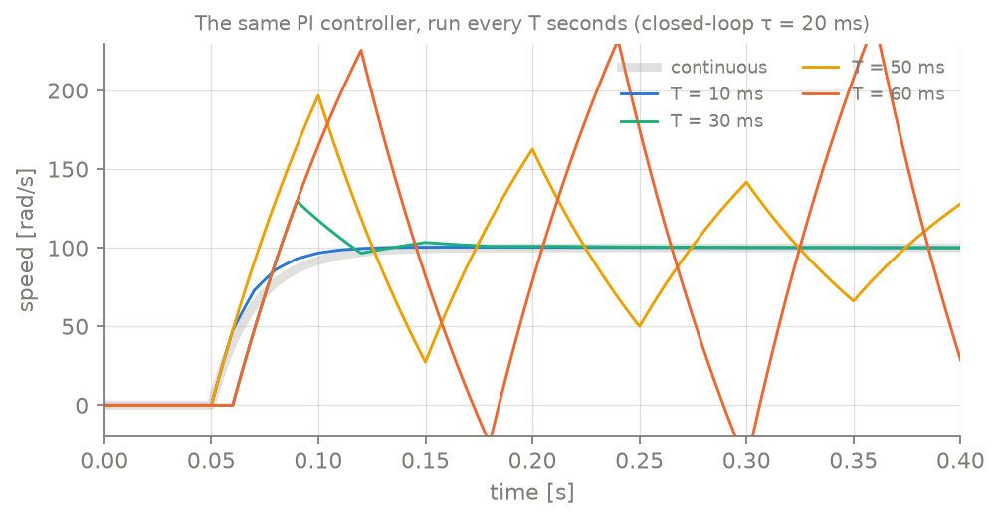
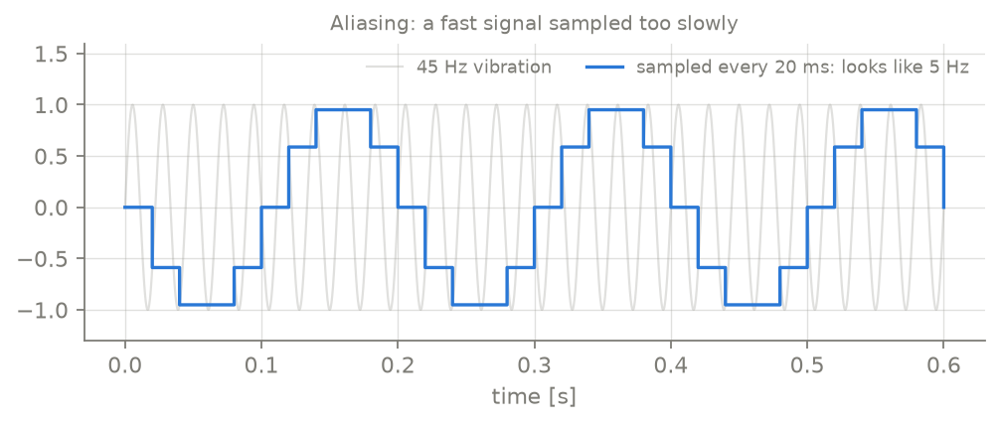

# Tutorial: From continuous to discrete: sample times

| | |
|---|---|
| **You will learn** | what running a controller every T milliseconds does to a loop, the zero-order hold, choosing a sample time, discrete poles and stability, aliasing and anti-aliasing filters |
| **Before this** | *Your first model: a cruise control*; read *Sample times* first |
| **Level and time** | beginner, about 30 minutes |
| **Follow along** | start the editor (`uv run nervus`), **File ▸ Open** `examples/discrete_control.nervus`, `examples/aliasing.nervus`, press **▶** and double-click the scopes; the figures below come from the same model |
| **Topic** | ECU software, communication and diagnostics ▸ From model to ECU code (*all tutorials*) |

A controller on an ECU does not run continuously. A task wakes up every few milliseconds, reads its sensors,
computes a new output and writes it to the actuator, and that output then stays put until the next run. This
tutorial shows what that does to a control loop. Below some sample time, nothing changes. Above it, the loop
overshoots, then rings, then goes unstable. It also shows the trap in the other direction: a signal that is too
fast for the sample time turns into a slow one that isn't there.

```bash
uv run python examples/discrete_control.py
```

## The model

`discrete_control.nervus` holds the same control loop twice. The plant is the speed of a DC motor, a first-order
lag with gain $K = 2$ rad/s per volt and time constant $\tau = 0.1$ s:

$$ G(s) = \frac{K}{\tau s + 1} $$

The controller is a PI controller. Its gains are chosen to **cancel the motor's pole** ($K_i / K_p = 1/\tau$),
which makes the closed loop a clean first-order lag with the time constant we ask for, $\tau_{cl} = 20$ ms:

$$ K_p = \frac{\tau}{K \tau_{cl}} = 2.5, \qquad K_i = \frac{K_p}{\tau} = 25 $$

All of this is in the **Model Workspace**: `Kp` and `Ki` are expressions of `K`, `tau` and `tau_cl`, so they follow
when you change the motor.

- The **top loop** uses the continuous **PID Controller** block. This is the controller on paper.
- The **bottom loop** is the controller as an ECU runs it: a **Zero-Order Hold** (`sensor`) reads the speed every
  `T` seconds, and a **Discrete PID Controller** with the same gains computes the voltage at the same moments and
  holds it until the next one. `T` is a workspace variable, 10 ms to start with.

Turn on **View ▸ Sample Time Colours**: the discrete blocks change colour, and the legend in the status bar shows
which colour is which rate. Blocks with an inherited sample time (`-1`) take the colour of the rate that drives
them.

## Run it

Press **▶** and open the scope. At $T = 10$ ms the two loops are almost on top of each other: the discrete one
overshoots by 0.4 %, and the continuous one not at all.

Now change `T` in the workspace and run again. The figure shows four runs:



| T | T / τ<sub>cl</sub> | Overshoot | What happens |
|---|---|---|---|
| 1 ms | 0.05 | 0 % | the same as continuous |
| 10 ms | 0.5 | 0.4 % | hardly different |
| 20 ms | 1 | 1.6 % | a visible step in the curve, still fine |
| 30 ms | 1.5 | 30 % | overshoot, then an oscillation that dies out |
| 50 ms | 2.5 | 97 % | the loop rings for a long time |
| 60 ms | 3 | — | unstable: the speed grows, flipping direction every sample |

The rule of thumb that comes out of this: **sample at least 5 to 10 times faster than the closed-loop time
constant**, here 2 to 4 ms. Then the discrete controller behaves like the one you designed. ECU tasks of 1, 5, 10
and 100 ms exist for this reason. Fast loops, such as current control or throttle position, run at 1 ms. Slow
ones, such as coolant temperature, run at 100 ms.

## Why it goes wrong

Between two samples the controller is blind. It computed its output from the speed at the last sample, and it
keeps applying that output while the motor moves on. The longer the gap, the more the controller acts on old
news. On average a held output lags the signal by half a sample period, $T/2$, and a lag in a feedback loop eats
phase margin. With too little margin the loop overshoots, and with none it oscillates.

Because the discrete loop has a closed form, the limits are exact. The motor seen from the controller, sample to
sample, is

$$ y[k+1] = a\,y[k] + b\,u[k], \qquad a = e^{-T/\tau}, \quad b = K (1 - a) $$

With the discrete PI controller, the closed-loop poles are the roots of

$$ (z - 1)(z - a) + b \left( K_p (z - 1) + K_i T \right) = 0 $$

A discrete loop is stable when every pole is inside the unit circle, $|z| < 1$. A pole on the negative real
axis makes the output flip sign from sample to sample: the ringing in the figure. For this loop:

- for $T < 23$ ms both poles are positive: no ringing, only a small overshoot;
- at $T = 23$ ms one pole goes negative, and the loop rings;
- at $T = 58$ ms that pole leaves the unit circle at $z = -1$, and the loop is unstable.

The script `examples/discrete_control.py` computes the overshoot for each sample time with a sweep, as in
*Scripting and testing models from Python*.

> **Retuning helps, up to a point:** A slower design tolerates a slower controller. With `tau_cl` = 0.1 the 50 ms controller overshoots by 2.9 % instead of 97 %, but the loop is then five times slower. Sample time and bandwidth are traded against each other. You cannot make a slow task control a fast plant.

## Aliasing: the other trap

Sampling also fails when the **signal** is too fast for the sample time. Open `aliasing.nervus`: a sensor
signal with a 45 Hz vibration (a sine) is read every 20 ms, that is at 50 Hz.



The samples trace a smooth **5 Hz** wave, and nothing in the samples tells it apart from a real 5 Hz signal. That
is **aliasing**. A frequency $f$ above half the sample rate (the **Nyquist frequency**, $f_s/2$) shows up at
$|f - n f_s|$ for the nearest whole $n$: here $|45 - 50| = 5$ Hz. A controller would react to it as if it were real.

No software after the sampler can undo this. The cure is in hardware, before the ADC: an **anti-aliasing filter**,
a low-pass (often a simple RC network on the ECU's input pin) that removes everything above the Nyquist frequency.
*An NTC temperature sensor interface* has one.

## Experiments

| Try | What you will see |
|---|---|
| `T` = 0.023 | the edge of ringing: 2.7 % overshoot and no undershoot yet; at 0.03 the undershoot appears |
| `T` = 0.06 | unstable; the Diagnostics panel stays quiet, because unstable is not an error |
| `T` = 0.05, `tau_cl` = 0.1, stop time 1.5 | the slow design copes with the slow controller: 2.9 % overshoot, settled in about 1 s |
| in `aliasing.nervus`, `f_signal` = 55 | also 5 Hz: 45 Hz and 55 Hz are indistinguishable at 50 Hz |
| in `aliasing.nervus`, `f_signal` = 50 | 0 Hz: a constant, because every sample hits the sine at the same phase |
| `T` = 0.01, and set `sample_time` of `pi_discrete` to 0.02 | mixed rates: the colours show the controller now runs slower than its sensor |

## Next

Next in this topic: *From model to ECU C code*. Or pick another one from the *tutorial overview*.
