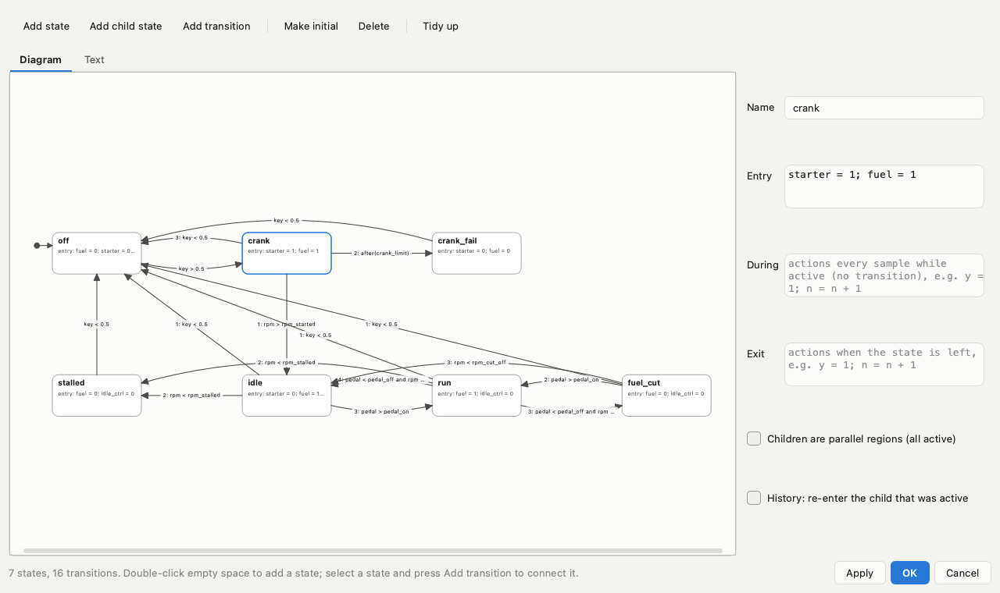

# Tutorial: Engine operating modes

| | |
|---|---|
| **You will learn** | an ECU's mode logic as a State Chart: cranking, starter protection, idle, fuel cut-off, stall; calibration parameters in a chart; behaviour specified by test cases |
| **Before this** | *Your first model: a cruise control* |
| **Level and time** | beginner, about 30 minutes |
| **Follow along** | start the editor (`uv run nervus`), **File ▸ Open** `examples/engine_modes.nervus`, press **▶** and double-click the scopes; the figures below come from the same model |
| **Topic** | Powertrain and engine control ▸ Engine management (*all tutorials*) |

`examples/engine_modes.py` models the mode logic at the heart of every engine ECU: is the engine off,
cranking, idling, running, coasting with the fuel cut off, or stalled? It is a **State Chart** running every
10 ms, and its behaviour is specified by **test cases** that drive the key, engine speed and pedal.

```bash
uv run python examples/engine_modes.py
```

## The modes

| Mode | When | What the ECU does |
|---|---|---|
| off | key off | no fuel, no ignition |
| crank | key on, engine below 600 rpm | starter on, fuel on (cranking enrichment) |
| crank_fail | cranking for more than 3 s | starter off to protect it, until the key is turned off |
| idle | engine runs, pedal released | the idle speed controller holds the speed |
| run | pedal pressed | torque follows the driver |
| fuel_cut | coasting above 1500 rpm with the pedal released | injectors off: no fuel is needed to coast |
| stalled | the engine stopped while the key is on | no fuel and no automatic restart |

The thresholds are `param` names in the chart, so they are **calibration parameters** in the Model Workspace:
`rpm_started` (600 rpm), `crank_limit` (300 samples of 10 ms = 3 s), `rpm_cut_on` (1500 rpm), `rpm_cut_off`
(1100 rpm) and so on.

Double-click the **modes** block: the chart editor shows the modes as states and the conditions as arrows. Click
the arrow from *crank* to *idle* to see its guard, `rpm > rpm_started`; the number in front of it, 1, means it is
checked first of the three transitions leaving *crank*. See *the chart editor*.



## Follow the scenarios

The model has no sources of its own: its inputs come from the four test cases. Open the **Test Manager** tab and
press **Run All** (Ctrl+T); all four pass. Double-click a result to see its signals in the Data Inspector.

- **normal start**: key on at 0.5 s; the engine cranks at 250 rpm and catches at 1.8 s (crank → idle).
- **failed start protects the starter**: the engine never starts; after exactly 3 s of cranking the chart goes to
  *crank_fail* and switches the starter off.
- **overrun fuel cut-off**: the driver lifts the pedal at 4 s with the engine at 3000 rpm. The chart cuts the fuel
  (*fuel_cut*) and gives it back at 7.6 s, when the speed falls below 1100 rpm, early enough that the engine
  does not stall:


- **stall**: the speed drops below 300 rpm at 2.4 s: *stalled*, no fuel, and the chart stays there until the
  key is turned off.

The order of the transitions matters: in *run*, `run -> fuel_cut` is written before `run -> idle`, so coasting
at high speed cuts the fuel instead of going to idle. The Model Advisor (Analysis ▸ Model Advisor) checks charts
for states that can never be reached and for transitions that can never fire.

## Experiments

Change a value in the Model Workspace and press **Run All** in the Test Manager:

| Try | What you will see |
|---|---|
| `crank_limit` = 100 (1 s) | two tests fail: *normal start* (this engine needs 1.3 s of cranking, the chart gives up at 1.5 s) and *failed start* (it specifies 3 s of cranking): the tests are the specification |
| `rpm_cut_off` = 800 | *overrun fuel cut-off* fails: the speed never falls below 800 rpm in the scenario, so the fuel never comes back (in a car the engine would stall) |
| `rpm_cut_on` = 3500 | no fuel cut-off at all: the chart stays in *run* until 7.4 s and then goes to *idle*; the fuel is never switched off |
| in the chart editor, select *crank* → *off* (`key < 0.5`) and press **Check earlier** twice | no change in these scenarios: the key stays on while cranking. The order matters only when two guards are true at the same time |

The chart can be generated as C code (Code ▸ Generate C Code), and a back-to-back test checks the code against
the simulation; see *C code generation*.

## Next

Next in this topic: *Radiator fan control*. Or pick another one from the *tutorial overview*.
