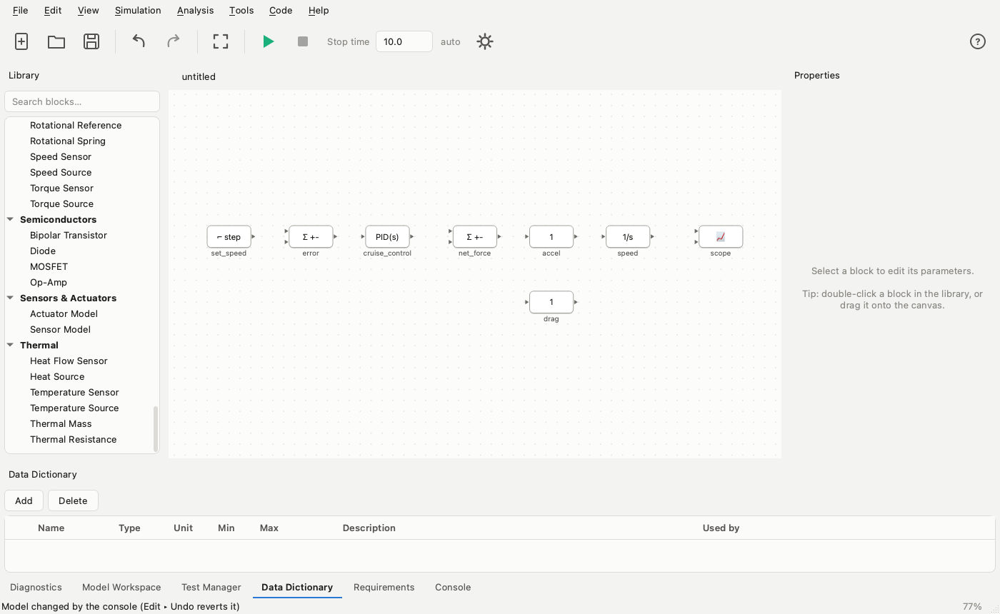
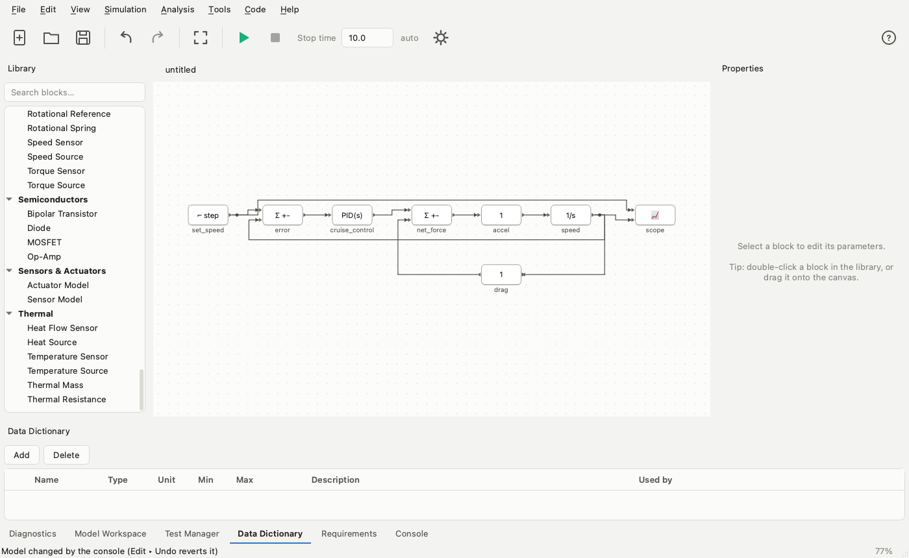
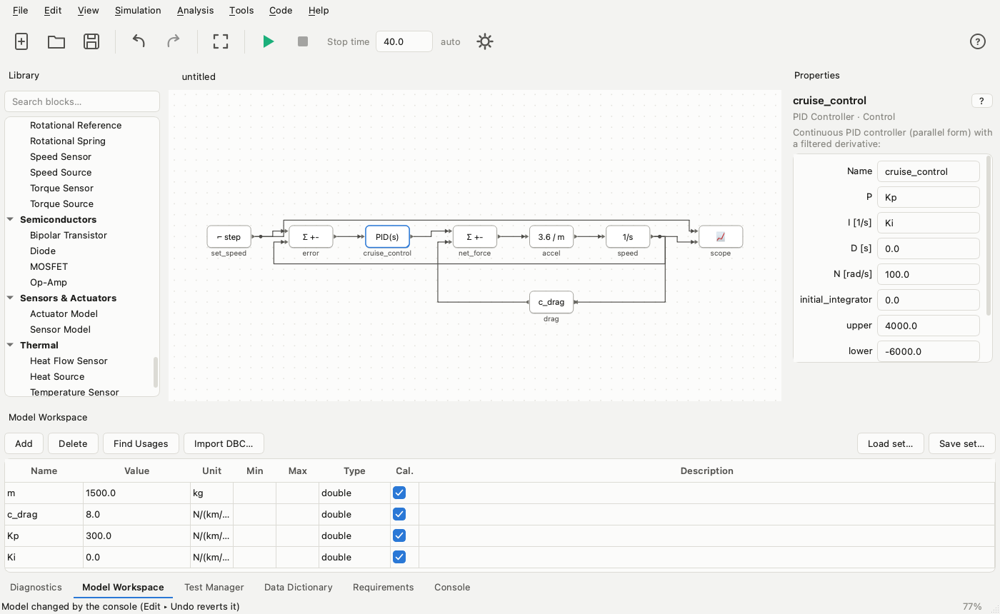
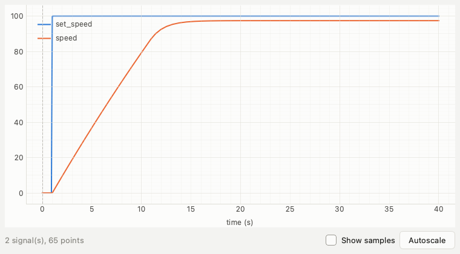
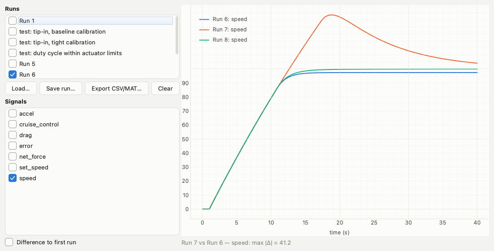

# Tutorial: Your first model: a cruise control

| | |
|---|---|
| **You will learn** | the editor, blocks and wires, workspace variables, scopes, the Data Inspector, PI control and integrator windup |
| **Before this** | nothing: start here (the editor needs `uv sync --extra gui`) |
| **Level and time** | beginner, about 30 minutes |
| **Follow along** | build the model yourself, step by step below; the finished model is `examples/cruise_control.nervus` |
| **Topic** | Getting started ([all tutorials](tutorials.md)) |

We build a **cruise control**: a controller that adjusts the engine force so the car holds a set speed. On the
way you meet the most common effect in control engineering, **integrator windup**, and fix it.

## The idea

The car accelerates with the engine force $F$ and is slowed by the drag, which we take as proportional to the
speed $v$ (in km/h):

$$ m \frac{dv}{dt} = F - c \cdot v $$

The controller compares the set speed with the actual speed and computes the force. In a block diagram, the
equation becomes a loop: *set speed → error → controller → force → car → speed → back to the error*.

## Step 1: start the editor and add the blocks

```bash
uv run nervus
```

You get an empty model. Add these 8 blocks. To add a block, type its name in the **search box** above the
library (top left) and **drag** it onto the canvas (or double-click it in the library). Then give it the name
in the table: select the block and edit **Name** at the top of the **Properties** panel (right).

| Library block | Name it | What it does |
|---|---|---|
| Step (Sources) | `set_speed` | the driver sets 100 km/h at t = 1 s |
| Sum (Math Operations) | `error` | set speed − speed |
| PID Controller (Control) | `cruise_control` | the controller |
| Sum | `net_force` | engine force − drag |
| Gain (Math Operations) | `accel` | force → acceleration |
| Integrator (Continuous) | `speed` | acceleration → speed |
| Gain | `drag` | speed → drag force |
| Scope (Sinks) | `scope` | shows the result |

Arrange them roughly like this, with `drag` below the main line:



## Step 2: connect the blocks

Drag from an **output port** (the small arrow on the right side of a block) to an **input port** (left side).
Make these 10 connections:

1. `set_speed` → `error` input 1, and `set_speed` → `scope` input 1
2. `error` → `cruise_control` → `net_force` input 1
3. `net_force` → `accel` → `speed`
4. `speed` → `error` input 2 (the feedback), `speed` → `drag`, and `speed` → `scope` input 2
5. `drag` → `net_force` input 2

`drag` points the wrong way for a feedback path: select it and press **Ctrl+Shift+F** (⌘⇧F on a Mac) to
flip it, so its input is on the right. The lines route themselves around the blocks:



> **Check your work:** The **Diagnostics** tab at the bottom says *No problems found* when every input is connected. If it lists an unconnected input, click the message: the block is selected for you.

## Step 3: set the parameters

First the **model workspace**: open the **Model Workspace** tab at the bottom, press **Add** four times and
fill in the table (double-click a cell to edit it):

| Name | Value | Unit |
|---|---|---|
| `m` | 1500 | kg |
| `c_drag` | 8 | N/(km/h) |
| `Kp` | 300 | N/(km/h) |
| `Ki` | 0 | N/(km/h·s) |

Now select each block and set its parameters in the **Properties** panel. Parameters can use the workspace
names, so you can tune later without touching the blocks:

| Block | Parameters |
|---|---|
| `set_speed` | time `1`, final `100` |
| `error`, `net_force` | signs `+-` (the first input is added, the second subtracted) |
| `cruise_control` | P `Kp`, I `Ki`, upper `4000`, lower `-6000` (the engine's and the brakes' limits in N) |
| `accel` | gain `3.6 / m` (the 3.6 converts m/s to km/h) |
| `drag` | gain `c_drag` |
| `scope` | num_inputs `2` |

Press Enter after typing a value. Click in a field (or hover over it) to see what you can write there, e.g. for
*signs* that `+-` subtracts the second input; press **F1** for the block's
help page.

Finally set the **Stop time** in the toolbar to `40`.



## Step 4: run and look at the result

Press **▶** (or **Ctrl+R**), then double-click the `scope`:



The car accelerates at full force (the controller output is at its 4000 N limit), but it settles at
**97.4 km/h**, not 100. Why? At 100 km/h the drag is 800 N, and a P controller only produces force when there
is an error: it needs $800 / (300 + 8) \approx 2.6$ km/h of error to push 800 N. This **steady-state error** is
typical of P control.

## Step 5: add integral action, and meet windup

The integral term keeps increasing the force as long as there is any error, so it removes the steady-state
error. In the Model Workspace set **`Ki` = 30** and run again.

Now open **Simulation ▸ Data Inspector** (**Ctrl+I**). Tick both runs and the signal `speed`:



Run 2 (orange) reaches 100 km/h, but only after shooting up to **139 km/h**. While the car was accelerating
at the 4000 N limit, the integrator kept adding up the large error ("winding up"). When the speed finally
reached 100 km/h, the integrator held so much that the controller kept pushing, and it took many seconds to
unwind. This is **integrator windup**, and it happens in every controller with an output limit: throttle,
idle speed, boost pressure.

## Step 6: fix it with anti-windup

Select `cruise_control` and set **anti_windup** to `clamping`: the integrator stops integrating while the
output is at its limit. Run again. Run 3 (green) reaches 100 km/h with no overshoot and settles in about
15 s.

| Run | Controller | Highest speed | After 40 s |
|---|---|---|---|
| 1 | P | 97.4 km/h | 97.4 km/h |
| 2 | PI | 138.6 km/h | 104.1 km/h |
| 3 | PI with anti-windup | 100.0 km/h | 100.0 km/h |

## Step 7: save, and make it a test

Save with **Ctrl+S** (for example as `cruise_control.nervus`). The file is plain JSON, so it works well with
Git.

To make sure nobody breaks the controller later, add a **test case**: in the **Test Manager** tab press
**Add**, set the stop time to 40 and add a check *bounds* on `speed` with upper limit `101`. Press **Run All**
(**Ctrl+T**): it passes now, and it fails if someone removes the anti-windup. See
[Test cases](testing.md).

## The same in Python

Every model can also be built and run from Python, for scripts, sweeps and CI.
[`examples/cruise_control.py`](https://github.com/ikjbi/nervus/blob/main/examples/cruise_control.py) builds this
model and runs the three versions:

```python
from nervus import simulate
from cruise_control import build  # in examples/

for ki, aw in ((0, "none"), (30, "none"), (30, "clamping")):
    res = simulate(build(ki=ki, anti_windup=aw))
    print(ki, aw, res["speed"].max())
```

## Experiments

Change a value in the **Model Workspace**, press **▶**, and compare with the earlier runs in the Data
Inspector.

| Try | What you will see |
|---|---|
| `m` = 2500 (a loaded car) | slower acceleration and a small overshoot (100.4 km/h); the controller still settles at 100 |
| `Kp` = 1000 | P only: the steady error shrinks to 0.8 km/h, but never disappears |
| `Ki` = 200 with anti-windup | a stronger integral action: the speed overshoots to 103 km/h before settling |
| `cruise_control` upper = 2000 | a weaker engine: it takes twice as long to get close to 100 km/h |

## Next

Next in this topic: [Reusable components with subsystems, masks and libraries](tutorial_component_libraries.md). Or pick another one from the [tutorial overview](tutorials.md).
