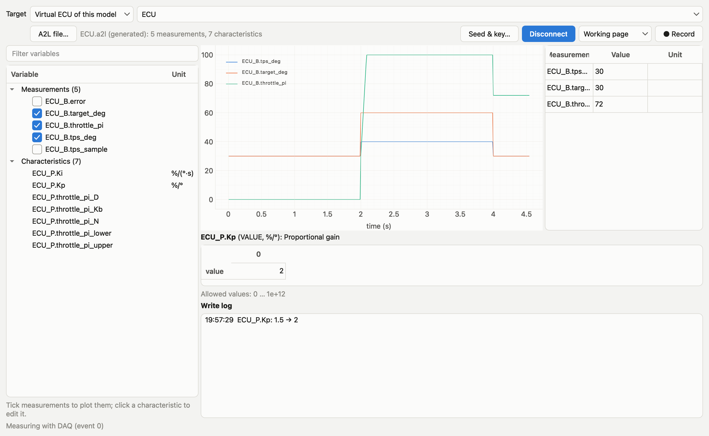

# Measurement and calibration

**Tools → Calibration…** measures and calibrates an ECU while it runs, like ETAS INCA or Vector CANape: it
reads the ECU's variables (**measurements**) and changes its parameters (**characteristics**: values, curves and
maps) over **XCP**. What the ECU contains, and where, comes from its **A2L file**.



!!! warning "Only on a bench or a test vehicle"
    Changing an ECU's calibration changes how the vehicle behaves. Use it on test benches and test vehicles,
    never on a vehicle on public roads. Changes to emissions or safety functions are illegal in most countries.
    Nervus refuses values outside the limits in the A2L file and logs every write, but you are responsible for
    what you change.

## Connect

Choose the **target**:

| Target | For | Address |
|---|---|---|
| **Virtual ECU of this model** | trying everything without hardware: the generated C code of the model (or of a subsystem such as `ECU`) runs in real time on your computer | the subsystem |
| **XCP on UDP** / **XCP on TCP** | ECUs and development boards on Ethernet | `host:port`, e.g. `192.168.1.10:5555` |
| **XCP on CAN** | ECUs on CAN, through a CAN adapter ([Hardware](hardware.md)) | `interface:channel:bitrate:request id:response id`, e.g. `pcan:PCAN_USBBUS1:500000:0x7E0:0x7E8` |

For a real ECU, choose its **A2L file** first. If the A2L file describes the connection (the CAN identifiers and
baud rate, or the IP address and port in its `IF_DATA XCP`), the address is filled in from it. Press
**Connect**.

ECUs that protect calibration ask for **seed and key**: the ECU sends a random *seed*, and the tool must answer
with the *key* computed by the supplier's algorithm. Put that algorithm in a Python file with a function
`key(seed: bytes) -> bytes` and choose it with **Seed & key…** before you connect.

The **virtual ECU** needs a C compiler (as for [software-in-the-loop tests](codegen.md)). Nervus generates the
code, compiles it, takes the addresses of the variables from the compiled code and writes them into the A2L file,
so it behaves like a real ECU: the same windows, the same protocol, the same file.

## Measure

Tick measurements in the list on the left. They appear in the plot (the last 10 seconds) and in the table
with their current value. Nervus asks the ECU to send them by itself at every cycle of its task (**DAQ lists**,
with the ECU's time stamps). If the ECU cannot (no DAQ, or a value is too big for a CAN packet), Nervus reads
them in turn (**polling**); the status line says which.

**● Record** records the ticked measurements until you press it again. The recording opens in the
[Data Inspector](testing.md#data-inspector), next to simulations, and can be saved as **MDF4** (for INCA,
CANape and other tools) or as a Nervus result.

## Calibrate

Click a characteristic to read it from the ECU:

- a **value**: one cell;
- a **curve**: its values over the axis points, with a plot;
- a **map**: a table with the X axis down the side and the Y axis across the top, coloured by value, and a plot
  with one line per column.

Edit a cell and press Enter: Nervus checks the value against the limits in the A2L file, converts it to the
ECU's raw value (with the conversion method of the A2L file), writes only the bytes that change, and reads the
characteristic back. Every write is listed in the **write log** with the old and the new value.

**Working page / Reference page.** ECUs keep two copies of their calibration: the **working page** in RAM,
which you change, and the **reference page** with the original, safe values. Switching to the reference page
puts the safe calibration back in one click (it cannot be changed); switching back restores your changes.

## A2L files

Nervus reads the A2L files of any ECU (ASAM MCD-2 MC): measurements (also arrays and bit masks),
characteristics of type `VALUE`, `VAL_BLK`, `CURVE` and `MAP`, axis points stored in the record (`STD_AXIS`),
computed (`FIX_AXIS`) or shared with other maps (`COM_AXIS` and `AXIS_PTS`), conversion methods (`IDENTICAL`,
`LINEAR`, `RAT_FUNC`, tables with and without interpolation, verbal tables), record layouts with alignment and
static layouts, byte order, memory segments (only `DATA` segments are written), and the XCP connection.

```python
from nervus.a2l import load_a2l
from nervus.xcp import UdpTransport, XcpMaster

a2l = load_a2l("ecu.a2l")
master = XcpMaster(UdpTransport("192.168.1.10", 5555))
master.connect()
ign = a2l.characteristics["ign_map"]
record = master.upload(ign.address, ign.size(a2l))
table = ign.decode(record, a2l)  # {"values": [[...], ...], "axes": [[rpm...], [load...]]}
table["values"][2][3] += 1.5  # one more degree of ignition advance at one point
master.download(ign.address, ign.encode(table["values"], a2l, record))
```

## XCP from Python

`nervus.xcp.XcpMaster` is the same tool without the window, for scripts and automated tests:

```python
from nervus.xcp import CanTransport, REFERENCE_PAGE, XcpMaster

master = XcpMaster(CanTransport(bus, 0x7E0, 0x7E8), a2l="ecu.a2l")
master.connect()
master.unlock(my_key_function)  # if the ECU is protected
master.start_daq(["engine_speed", "lambda"], event=0)
samples = master.read_daq()  # {"engine_speed": [(t, value), ...], ...}
master.set_page(REFERENCE_PAGE)  # the safe calibration
```

A virtual ECU from the command line, for INCA, CANape or a script:

```bash
uv run python -m nervus.vecu examples/throttle_ecu.nervus --subsystem ECU --udp 5555
```

It writes `ECU.a2l` with the real addresses and serves XCP on UDP port 5555 (and on CAN with `--can`).

## Against the simulation

A model with an [XCP Slave](blocks/can.md) block can be calibrated while it simulates: give its CAN Bus block an
interface (for example `virtual`), set pacing to real time, and connect with **XCP on CAN** to the same interface
and channel (see the [XCP tutorial](tutorials/xcp-calibration.md)).
