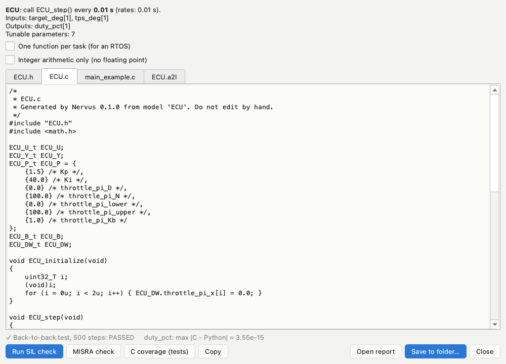

# C code generation

Nervus generates plain C99 code from the discrete-time part of a model, the way Simulink Embedded Coder
does. The code uses only static memory (no `malloc`, no recursion). It is verified against the model by a
**back-to-back (software-in-the-loop) test** that compiles it and compares every output at every step.



## Workflow

1. Put everything that runs on the ECU in a **subsystem**. Its In/Out blocks are the software interface
   (sensors in, actuators out). The plant stays outside and is not generated.
2. Make sure the subsystem is **discrete-time**: give the controller blocks a sample time (e.g. `Ts = 0.01`)
   and use a Zero-Order Hold where a continuous signal enters.
3. Select the subsystem and choose **Code → Generate C Code…** (⌘B / Ctrl+B). With nothing selected, the
   whole model is generated.
4. Press **Run SIL check**: the code is compiled with `-Wall -Wextra -Werror -pedantic`, driven with the same
   random input sequence as the model, and the largest difference is reported.
5. **Save to folder…** writes the files. **Open report** shows an HTML report with the interface, the
   parameters and links from every block to its lines of code.

The example [`examples/throttle_ecu.py`](https://github.com/ikjbi/nervus/blob/main/examples/throttle_ecu.py)
does all of this from Python. Its generated code is committed in
[`examples/generated/ECU/`](https://github.com/ikjbi/nervus/tree/main/examples/generated/ECU).

## Generated files

| File | Contents |
|---|---|
| `<name>.h` | types, the input/output/parameter/state structs, and the API |
| `<name>.c` | `<name>_initialize()` and `<name>_step()` |
| `main_example.c` | a template showing how to call the code from a periodic task |
| `<name>_sil.c` | accessors used only by the software-in-the-loop test |
| `<name>_report.html` | the code generation report |
| `<name>.a2l` | ASAM MCD-2 MC description for calibration tools (INCA, CANape, ...) |

Only `<name>.h` and `<name>.c` belong in the ECU project.

## The API

```c
#include "ECU.h"

void task_10ms(void)            /* every ECU_BASE_PERIOD seconds */
{
    ECU_U.target_deg[0] = pedal_map_output;
    ECU_U.tps_deg[0]    = read_throttle_sensor();
    ECU_step();
    set_hbridge_duty(ECU_Y.duty_pct[0]);
}

int main(void)
{
    ECU_initialize();
    start_timer(task_10ms, ECU_BASE_PERIOD);
    for (;;) { }
}
```

| Symbol | Meaning |
|---|---|
| `<name>_U` | inputs, one array per In block (write before each step) |
| `<name>_Y` | outputs, one array per Out block (read after each step) |
| `<name>_P` | **tunable parameters** (calibration data) |
| `<name>_B` | block signals (useful for measurement) |
| `<name>_DW` | states (delays, integrators, filters, ...) |
| `<NAME>_BASE_PERIOD` | how often to call `<name>_step()`, in seconds |

### Calibration parameters

A block parameter written as a **bare workspace variable** (`Kp`) becomes one shared field
`<name>_P.Kp`, so every block that uses `Kp` reads the same value and a calibration tool can change it at run
time. Other parameters get a field per block (`<name>_P.throttle_pi_N`). See
[Workspace and calibrations](workspace.md).

### What a step looks like

This is `ECU_step()` from the throttle example. Each block is a short commented section, in execution order:

```c
void ECU_step(void)
{
    uint32_T i;
    (void)i;

    /* outputs */
    /* target_deg (In) */
    ECU_B.target_deg[0] = ECU_U.target_deg[0];
    /* tps_deg (In) */
    ECU_B.tps_deg[0] = ECU_U.tps_deg[0];
    /* tps_sample (Zero-Order Hold) */
    ECU_B.tps_sample[0] = ECU_B.tps_deg[0];
    /* error (Sum) */
    ECU_B.error[0] = ECU_B.target_deg[0] - ECU_B.tps_sample[0];
    /* throttle_pi (Discrete PID Controller) */
    {
        real_T err = ECU_B.error[0];
        real_T d_term = ECU_P.throttle_pi_D[0] * ECU_P.throttle_pi_N[0] * (err - ECU_DW.throttle_pi_x[1]);
        real_T unsat = ECU_P.Kp[0] * err + ECU_DW.throttle_pi_x[0] + d_term;
        real_T y = fmin(fmax(unsat, ECU_P.throttle_pi_lower[0]), ECU_P.throttle_pi_upper[0]);
        ECU_B.throttle_pi[0] = y;
    }
    /* duty_pct (Out) */
    ECU_Y.duty_pct[0] = ECU_B.throttle_pi[0];

    /* state updates */
    /* throttle_pi (Discrete PID Controller) */
    {
        real_T err = ECU_B.error[0];
        real_T d_term = ECU_P.throttle_pi_D[0] * ECU_P.throttle_pi_N[0] * (err - ECU_DW.throttle_pi_x[1]);
        real_T unsat = ECU_P.Kp[0] * err + ECU_DW.throttle_pi_x[0] + d_term;
        real_T y = fmin(fmax(unsat, ECU_P.throttle_pi_lower[0]), ECU_P.throttle_pi_upper[0]);
        real_T di = ECU_P.Ki[0] * err;
        if ((unsat != y) && (((unsat - y) > 0.0) == (di > 0.0)) && (di != 0.0)) { di = 0.0; }
        ECU_DW.throttle_pi_x[0] += 0.01 * di;
        ECU_DW.throttle_pi_x[1] += 0.01 * ECU_P.throttle_pi_N[0] * (err - ECU_DW.throttle_pi_x[1]);
    }
}
```

## Calibration with A2L

`<name>.a2l` describes every tunable parameter as a `CHARACTERISTIC` and every block signal as a
`MEASUREMENT`, all `FLOAT64_IEEE`. Units, limits and descriptions come from the
[workspace variables](workspace.md), so `Kp` with unit `%/°` and range 0–10 appears exactly like that in the
calibration tool.

Memory addresses are only known after linking. The file contains placeholders, and these lines fill them in
from the built ECU binary:

```python
from nervus.codegen.a2l import fill_addresses, symbol_addresses

a2l = code.files["ECU.a2l"]
a2l = fill_addresses(a2l, symbol_addresses("build/ecu.elf"))  # uses `nm`
```

### Typed parameters and constants

Workspace variables can be stored as integer or fixed-point types and as constants in ROM (the **Type** and
**Cal.** columns of the Model Workspace, see *Workspace and calibrations*). Calibratable parameters are in
`<name>_P`, ordered by size (8, 4, 2, 1 bytes) so the struct has no padding and the A2L offsets are exact.
Constants are in `const <name>_C`, which the linker puts in flash, and they are not in the A2L file.

## Multi-rate models

When blocks run at different rates (e.g. 10 ms and 50 ms), `<name>_step()` is called at the **base rate**
(the greatest common divisor of the periods). Rate counters decide which blocks run in each step:

```c
for (i = 0u; i < 2u; i++) { rt_hit[i] = (rt_count[i] == 0u) ? 1u : 0u; }
...
if (rt_hit[1] != 0u) {  /* blocks of the 50 ms rate */
    ...
}
```

A rate with an **offset** (a sample time `[period, offset]`) runs first at its offset, but its blocks' outputs are
computed in the first call already (a delay's initial value, a hold's first input), as in the simulation; their
states change from the first hit on.

## One function per task (RTOS)

On a real ECU an operating system (an RTOS, e.g. AUTOSAR OS or FreeRTOS) runs the software in periodic
tasks, and a faster task interrupts a slower one. Tick **One function per task (for an RTOS)** in the
Generate C dialog (or `generate_c(model, tasks=True)`) to get one function per rate:

```c
void ecu_task_10ms(void);   /* call every 10 ms, highest priority */
void ecu_task_100ms(void);  /* call every 100 ms */
```

`main_example.c` then shows one OS task per rate, with the priorities to use. `ecu_step()` still exists:
called every base period, it runs the due tasks fastest first, which is what the SIL check compares with the
simulation.

**Signals between tasks need a Rate Transition block.** If the 10 ms task read the 100 ms task's output
directly, it would see the old or the new value depending on whether the slow task had finished, so the
result would depend on timing. A Rate Transition makes the transfer deterministic, in the simulation and on
the target:


| Direction | Set | Behaviour |
|---|---|---|
| `fast_to_slow` | *sample_time* = the slow rate | the slow task gets the fast signal as it was at the start of its period |
| `slow_to_fast` | *sample_time* = the slow rate, *output_sample_time* = the fast rate | the fast task gets the slow signal one slow period later |

The code generator checks the model: a signal that goes from one task to another without a Rate Transition
is reported with both block names. Blocks that get the model's In ports directly must have a rate of their
own: sample the inputs with a Zero-Order Hold, or put each task in an
[atomic subsystem](subsystems.md#atomic-subsystems-one-ecu-task) with its own *sample_time*.

## Supported blocks

**Supported:** 1-D/2-D Lookup Table, Abs, Bias, Compare To Constant, Constant, Counter, Dead Zone, Debounce, Demux, Discrete Filter (PT1), Discrete PID Controller, Discrete Transfer Fcn, Discrete-Time Integrator, Edge Detect, Gain (elementwise and matrix), Ground, In, Integer Delay, Logical Operator, Math Function, MinMax, Moving Average, Mux, Out, Product, Quantizer, Rate Limiter, Relational Operator, Relay, Saturation, Subsystems, Sum, Switch, Unit Delay, Zero-Order Hold (Scope, To Workspace and Terminator are ignored).

**Not supported** (simulation only): blocks with continuous states (Integrator, Transfer Fcn, State-Space,
PID Controller, Derivative), time-based sources (Step, Sine Wave, Ramp, Pulse, Clock, From Workspace) and
Python Function. Put these in the plant model outside the generated subsystem, or use their discrete
counterparts (Discrete-Time Integrator, Discrete Transfer Fcn, Discrete PID Controller).

Custom blocks can provide their own C template with `@nervus.codegen.template("my.block_type")`.

## Current limitations

- Floating-point code computes in `double` between the conversions of fixed-point signals (bit-true, see
  [Data types](datatypes.md)); [integer-only code](#integer-only-code-no-floating-point) supports a subset of the
  blocks.

## From Python

```python
from nervus import load
from nervus.codegen import generate_c
from nervus.codegen.sil import back_to_back

model = load("examples/throttle_ecu.nervus")
code = generate_c(model.block("ECU"))
code.write("build/ECU")

result = back_to_back(model.block("ECU"), {"target_deg": 60.0, "tps_deg": 5.0}, steps=500)
print(result.summary())
```

## Integer-only code (no floating point)

Small ECUs often have no floating-point unit. Tick **Integer arithmetic only** in the code generation dialog (or
`generate_c(model, integer_only=True)`) and the generated code has no `double` or `float` at all: every signal stays
its stored integer (`int16_T` for `fixdt(1, 16, 7)`, `uint8_T` for a boolean), and every block computes in an
`int64` accumulator. Moving the binary point is an integer multiplication, or a division rounded exactly as the
simulation rounds (`nv_div_nearest`, half away from zero; `floor`, `ceil`, `zero`), then the block's overflow
handling (`nv_sat` or `nv_wrap`). The results are the simulation's, **bit for bit**; the back-to-back test checks it
at zero tolerance.

```c
/* scale (Gain): 5/128 °C per ADC count, into fixdt(1, 16, 7) */
temp_B.scale[0] = (int16_T)nv_sat(((int64_T)5 * (int64_T)temp_B.z[0]), (int64_T)-32768, (int64_T)32767);
```

What it needs:

| Rule | Why |
|---|---|
| every signal has an integer, boolean or fixed-point type with **binary-point scaling** (slope 2^-n, no bias): set the types from the In blocks on | other scalings need real multiplications |
| a gain is an exact binary fraction (`0.75`, `0.0390625`), or a workspace variable with a fixed-point type (then it is calibratable as a stored integer) | `0.0123` is neither: the simulation would use a value the integer code cannot |
| blocks: In/Out, Constant, Sum, Gain, Product (`*`), Bias, Abs, MinMax, Relational Operator, Compare To Constant, Logical Operator, Switch, Saturation, Unit Delay, Integer Delay, Zero-Order Hold, Data Type Conversion, subsystem ports | the blocks of integer ECU code; others (a PID, a filter, a chart) need floating-point code |

A model that breaks a rule gets a message that names the block and the rule. Results that the simulation's double
arithmetic could round (more than 52 bits) are refused too, so the two always agree.

## Reusable functions for subsystems

Normally every block of a subsystem is written into the model's code (inline). When the same subsystem appears
several times, for example one injector or cylinder controller per cylinder, give the subsystems a **function
name** (the *function_name* parameter in the Properties panel). Subsystems with the same function name then share
**one C function**, called once per subsystem:

```c
/* cyl_trim.h: generated once */
void cyl_trim_initialize(cyl_trim_B_t *B, cyl_trim_DW_t *DW);
void cyl_trim_output(const cyl_trim_U_t *U, cyl_trim_Y_t *Y, cyl_trim_B_t *B, cyl_trim_DW_t *DW,
                     const cyl_trim_P_t *P);
void cyl_trim_update(cyl_trim_B_t *B, cyl_trim_DW_t *DW, const cyl_trim_P_t *P);

/* engine.c: each cylinder has its own signals, states and calibration */
cyl_trim_output(&in, &out, &engine_cyl0_B, &engine_cyl0_DW, &engine_cyl0_P);
```

Each subsystem keeps its own data: signals (`_B`), states (`_DW`) and calibration parameters (`<model>_<subsystem>_P`,
for example different trims per cylinder from a mask). The model calls `_output` where the subsystem's blocks would
compute their outputs and `_update` where they would update their states, so the code does exactly what the inline
code does; the back-to-back test compares it with the simulation.

The subsystems must have the same contents (blocks and wiring; their parameter *values* may differ), run at one rate
(their own *sample_time*) and have no enable or trigger port. The functions are in their own files
(`cyl_trim.c`, `cyl_trim.h`), which the ECU project builds with the model's code. Each instance's calibration
parameters are in the A2L file as `<model>_<subsystem>_P.<name>`.

## Coverage of the generated code

`nervus.codegen.c_coverage.coverage_of_tests(model, model.block("ECU"))` runs every test case of the model, records
the signals that enter the code at each of its steps, replays them into the generated C compiled with `--coverage`,
and reads gcov's counts: which lines and branches of the ECU code the tests execute (with each test's calibration).

```python
cov = coverage_of_tests(model, model.block("ECU"))
print(cov.summary())  # C code coverage: lines 100 % (25/25), branches 75 % (6/8) in 3 run(s), and what never ran
cov.save_html("ecu_coverage.html")
```

Many blocks become one-line conditionals (a Switch, a Saturation), so a missing test shows as a branch never taken
rather than a line. Needs a C compiler and gcov. In the editor: **C coverage (tests)** in the code generation
dialog shows the percentages and opens the annotated report.

## MISRA C

**MISRA C:2012** is the coding standard for safety-related C in the automotive industry: ISO 26262 asks for a coding
standard, and most ECU projects choose MISRA. The generated code follows it, and **MISRA check** in the code
generation dialog checks it with the free checker **cppcheck** and its MISRA addon (install it with
`brew install cppcheck` or `apt install cppcheck`). From Python:

```python
from nervus.codegen.misra import misra_check

findings = misra_check(generate_c(model.block("ECU")))  # [] : no findings
```

What the generated code does for it:

| Rule | In the generated code |
|---|---|
| 10.4, 7.2 | unsigned loop counters and index constants (`for (i = 0u; i < 4u; i++)`) |
| 12.1 | explicit parentheses: `(Kp * err) + x`, `(a != 0.0) && (b != 0.0)` |
| 14.4 | conditions are comparisons: `if ((st & 0x02u) != 0u)`, never `if (st & 0x02u)` |
| 15.7 | every `if … else if` chain ends with an `else` |
| 2.2, 2.3 | no `+ 0` in index expressions; only the type aliases the model uses |
| 8.9 | data used by one function only is declared in it (e.g. the rate periods) |
| 12.3 | one declaration per line |

The check analyses `<name>.c` and `<name>.h` (with `main_example.c`, so the calls of the step function count, but
its own findings are not reported). Three rules are **deviations**, as a MISRA compliance report records them:

| Rule | Why |
|---|---|
| 2.5 (advisory) | `<MODEL>_BASE_PERIOD` is part of the interface, for the scheduler that calls the step function |
| 8.7 (advisory) | `<model>_P` has external linkage so the calibration tool (XCP, A2L) and other ECU code reach the parameters |
| 7.3 | a false positive of the addon: the last letter of an identifier like `pedal` taken for an `l` suffix |

The test suite checks the code of every block with a C template and several example ECUs this way, and compiles it
with `-std=c99 -Wall -Wextra -Werror -pedantic`. cppcheck checks the rules a tool can decide; a MISRA compliance
claim for a project also needs a review of the rules no tool can decide, and a compliance report. Many projects use
a commercial checker (PC-lint, Polyspace, QA-C) as well.

## FMI export

**Code ▸ Export FMU…** packs the generated code of the selected subsystem (or the whole model) as an **FMI 2.0
co-simulation FMU**, the standard format for exchanging models between tools (Simulink, Dymola, OpenModelica,
SimulationX, CANoe, fmpy). The FMU contains:

- `modelDescription.xml`: the inputs and outputs (In and Out blocks), the tunable parameters (the calibratable
  parameters of the `_P` struct, with their start values) and the default communication step (the base period);
- `binaries/<platform>/`: the library compiled for this computer (`darwin64`, `linux64` or `win64`), with the FMI
  functions (`fmi2Instantiate`, `fmi2DoStep`, `fmi2GetReal`, ...) around the generated step function;
- `sources/`: the generated C files and the FMI wrapper, so other platforms can build it.

Each `fmi2DoStep` runs the step function once per base period; the communication step must be a whole number of base
periods. The generated code keeps its state in global variables, so one process runs one instance. In Python:
`nervus.codegen.fmu.export_fmu(model.block("ECU"), "ECU.fmu")`.

The **FMU** block imports FMUs from other tools into a model (co-simulation, needs fmpy: `uv sync --extra fmi`). See
the [FMI tutorial](tutorials/fmi.md).

