# The editor

Start the desktop editor with:

```bash
uv sync --extra gui
uv run nervus                         # empty model
uv run nervus examples/throttle_pi.nervus
```

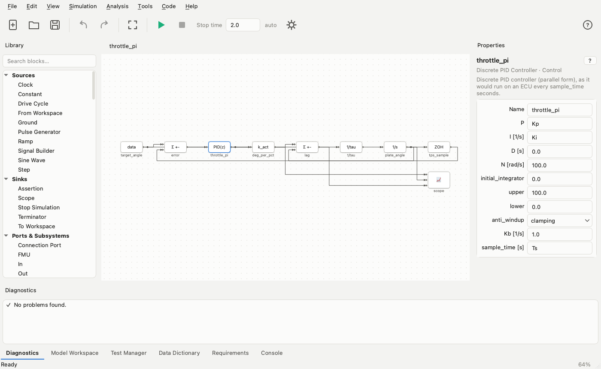

| Area | What it does |
|---|---|
| **Toolbar** | New / open / save, undo / redo, fit to window, **▶ Run** and **■ Stop**, the stop time, and the simulation settings. |
| **Library** (left) | All blocks by category, with search. Drag a block onto the canvas or double-click it. |
| **Canvas** (centre) | The diagram. Drag from an output port (▸ on the right of a block) to an input port to draw a line. |
| **Properties** (right) | Parameters of the selected block. Fields accept expressions (`2*pi`) and MATLAB-style matrices (`[1 2; 3 4]`). Click in a field, or hover over it, and the line under the fields says what you can write there. |
| **Model Workspace** (bottom, tab) | Named parameters (calibration data) that block parameters can use, and parameter sets. See [Workspace and calibrations](workspace.md). |
| **Test Manager** (bottom, tab) | Test cases saved with the model; run them and see pass/fail. See [Test cases and results](testing.md). |
| **Diagnostics** (bottom) | Problems such as unconnected inputs or algebraic loops. Click one to select the blocks involved; they also get a red outline. |

Dark mode follows the system setting, or choose it under **View → Theme**. Both themes use the same colour tokens
(one accent colour, tinted selections), so the panels, the canvas and the plots always match:

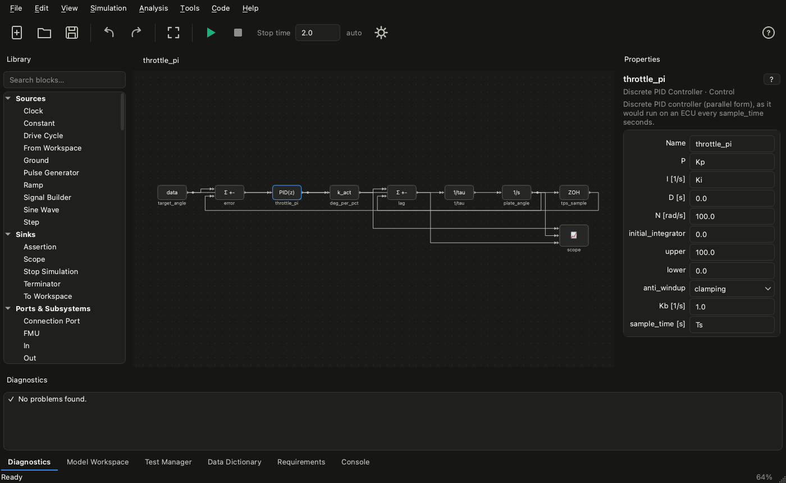

## Blocks

- **Select**: click, or drag a rectangle on empty canvas. Shift-click adds to the selection.
- **Move**: drag. Blocks snap to a 10-pixel grid.
- **Rename**: edit *Name* in the Properties panel, or right-click → *Rename…*. Names must be unique.
- **Delete**: Delete or Backspace.
- **Copy / cut / paste**: ⌘C / ⌘X / ⌘V (Ctrl on Windows and Linux). Lines between copied blocks are
  copied too.
- **Double-click**: opens a subsystem, the plot window of a Scope, or the Properties panel for other blocks.
- **Flip**: Ctrl+Shift+F swaps the input and output sides (see below).

## Lines (signals)

- Drag from an **output port** (right side, ▸) to an **input port** (left side). You can also start from an
  input and drag backwards to an output.
- An output can feed many inputs (a dot marks the branch). An input has exactly one source. Connecting a
  new line to an input that is already used replaces the old line.
- Click a line to select it; Delete (or right-click → *Delete Wire*) removes it.
- Lines are routed automatically with right angles. When the direct route would pass through a block, the
  line goes **around the blocks** (the shortest route with the fewest bends).
- **Drag a line segment** to place it yourself: the middle segments move sideways; the short segments at the
  ports follow the blocks. Lines from the same output move together at a shared segment, so dragging the
  segment at a branch moves the **branch point**. Manually placed lines keep their corners when blocks move
  (the ends follow the ports) and are saved with the model. Right-click → *Reset Route* returns to automatic
  routing.
- **Hover over a port** to see which input it is, e.g. *input 2: reset (rising)* on a Discrete-Time
  Integrator with an external reset, or *k1*, *f1* on an Interpolation block.

## Sample times, widths and data types on the canvas

The **View** menu can annotate the diagram with what the compiler found out:

| View → | Shows |
|---|---|
| **Show Data Types** | the data type on every wire that is not `double` (`int16`, `fixdt(1,16,8)`, ...) |
| **Show Signal Widths** | `[3]` on vector wires, which are also drawn thicker |
| **Sample Time Colours** | blocks and wires coloured by their sample time, with a legend in the status bar |

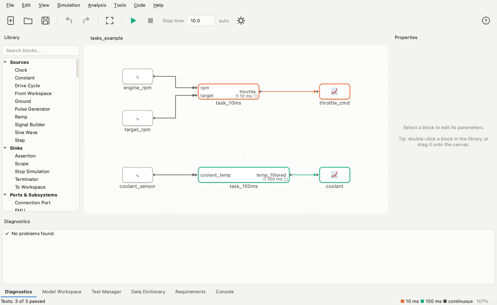

The discrete rates get colours from fastest to slowest (orange, green, blue, amber, ...); continuous blocks
keep the normal colour and constant blocks are pink. A subsystem whose blocks all run at one rate takes that
colour. Use it to check that every block of an ECU task really runs in that task, and to find where a
Rate Transition is needed. The annotations update while you edit, once the model compiles.

## Editing parameters

Numeric fields accept:

| You type | Meaning |
|---|---|
| `0.5`, `-1e-3` | numbers |
| `2*pi`, `1/0.05`, `sqrt(2)` | arithmetic; `pi`, `e`, `inf` are known |
| `[1 2 3]` or `[1, 2, 3]` | vectors |
| `[1 2; 3 4]` | matrices (rows separated by `;`, as in MATLAB) |
| `Kp`, `1/tau`, `2*Kp` | workspace variables and expressions of them |
| `Kp * (MODE == 2)`, `A > 1 && B ~= 0` | comparisons and logic give 1 or 0 (MATLAB `~=`, `&&`, `\|\|`, `~` work too) |

Press Enter or leave the field to apply. If a value is invalid the field turns red and the old value is
kept.

## Tidying up

**Edit → Auto Layout** (⇧⌘L / Ctrl+Shift+L) arranges the blocks of the shown diagram from left to right
in signal-flow order. It can be undone like any other edit.

## Undo

Every change, including moves, can be undone with ⌘Z and redone with ⇧⌘Z (Ctrl+Z / Ctrl+Y).

## Zoom and pan

- **Zoom**: ⌘/Ctrl + mouse wheel, trackpad pinch, or ⌘+ / ⌘−. **Fit to window**: ⌘0.
- **Pan**: two-finger scroll on a trackpad, the middle mouse button, or hold **Space** and drag.

## Right-click menus

Right-click a block, a wire or the empty canvas for the actions that fit it:

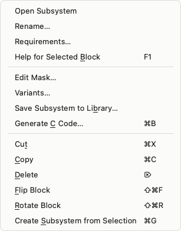

| On | Actions |
|---|---|
| a block | Rename, help, cut / copy / delete, create a subsystem from the selection; *Open Scope* for scopes |
| a subsystem | also *Open Subsystem*, *Edit Mask…*, *Variants…*, *Save Subsystem to Library…*, *Generate C Code…* (or *Break Library Link* when it is linked) |
| a wire | *Delete Wire* |
| the canvas | paste, select all, auto layout, fit to window, up to the parent system |

Right-clicking a block that is part of a selection keeps the selection, so *Delete* or *Create Subsystem*
act on all selected blocks.

## Flipping blocks for feedback paths

Feedback paths, such as a sensor signal going back to the controller, are easier to read when they run from
right to left. Select blocks and press **Ctrl+Shift+F** (**Edit → Flip Block**, or right-click → *Flip Block*):
their inputs move to the right side and their outputs to the left. Flipping only changes the drawing, and
it is saved with the model.

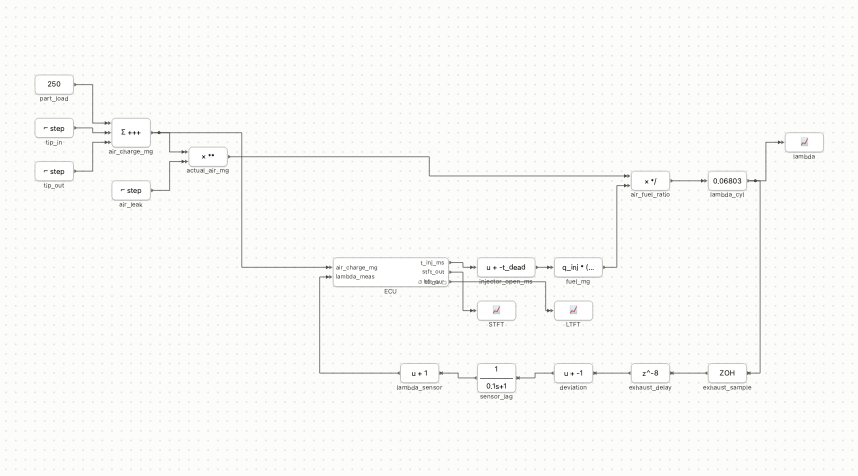

In Python, set `block.meta["flipped"] = True`.

## Rotating, resizing and nudging blocks

**Ctrl+Shift+R** (**Edit → Rotate Block**, or right-click → *Rotate Block*) turns the selected blocks a
quarter turn clockwise: the signal then flows down (inputs on top, outputs at the bottom), then to the left,
then up, then right again. Use it for signal chains drawn top to bottom, like a sensor path. Flipping a
rotated block swaps top and bottom.

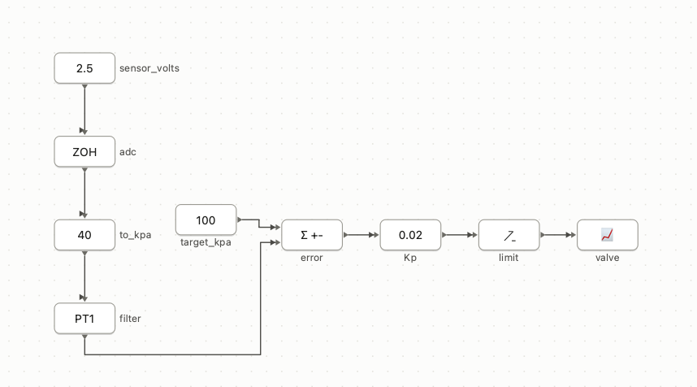

To make a block bigger, select it and drag the grip in its lower right corner; blocks never get smaller than
their natural size. **Edit → Reset Block Size** undoes it. The **arrow keys** move the selected blocks by one
grid step, **Shift+arrow** by five. All of these can be undone and are saved with the model.

In Python: `block.meta["vertical"] = True` (with `flipped` for upwards), `block.meta["size"] = [140, 80]`.

## Running a simulation

Press **▶ Run** (⌘R / Ctrl+R / F5). The simulation runs in the background, so the window stays responsive,
and **■ Stop** ends it early. Every Scope opens when the first run starts and plots live while the simulation
runs. Hover over a plot to read the values at that time:

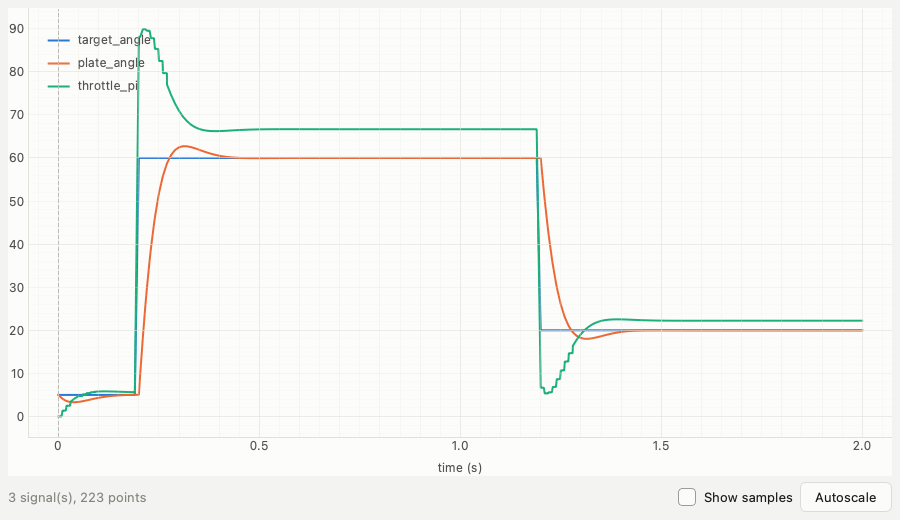

Solver, step size and tolerances are under **Simulation → Simulation Settings…** (⌘E):

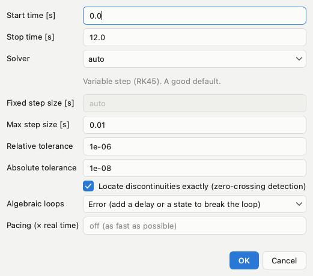

**Pacing** runs the simulation no faster than a multiple of real time (1 = real time), so live scopes of a
fast model can be watched; leave it empty to run as fast as possible.

## Scripting console

**View ▸ Console** (a tab next to the Model Workspace) runs Python with the open model and its results in
scope:

| Name | What it is |
|---|---|
| `model` | the open model (a `Diagram`): `model.block("pid").params`, `model.workspace["Kp"]` |
| `res`, `runs` | the last result and all runs in the Data Inspector: `res["speed"].max()` |
| `simulate`, `load`, `save` | run, open and save models |
| block classes, `blocks` | `model.add(Gain(gain=2), name="k")` |
| `np`, `plt` | NumPy and Matplotlib |
| `window` | the main window, for scripting the app itself |

Statements over several lines work as in the Python prompt (finish with an empty line); ↑ and ↓ recall
earlier lines. Errors are printed in the console. Changes a statement makes to the model appear in the
editor at once and are **one undo step** (*Edit ▸ Undo* reverts them). Assigning another model to `model`
(e.g. `model = load("examples/drive_cycle.nervus")`) opens it.

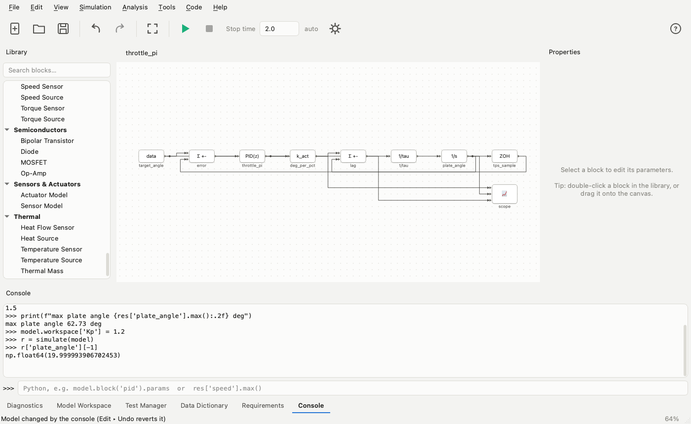

## Built-in help

**Help → Nervus Help** opens the guide and the full block reference inside the app. The list on the left has the
guide pages, then **Tutorials** and **Block reference**: click one to fold it open (the tutorials by topic, the blocks
by category). Links between pages open in the Help window. Select a block and press
**F1** (or **?** in the Properties panel) to jump straight to its page. Equations are typeset, and many blocks
have explanatory figures:

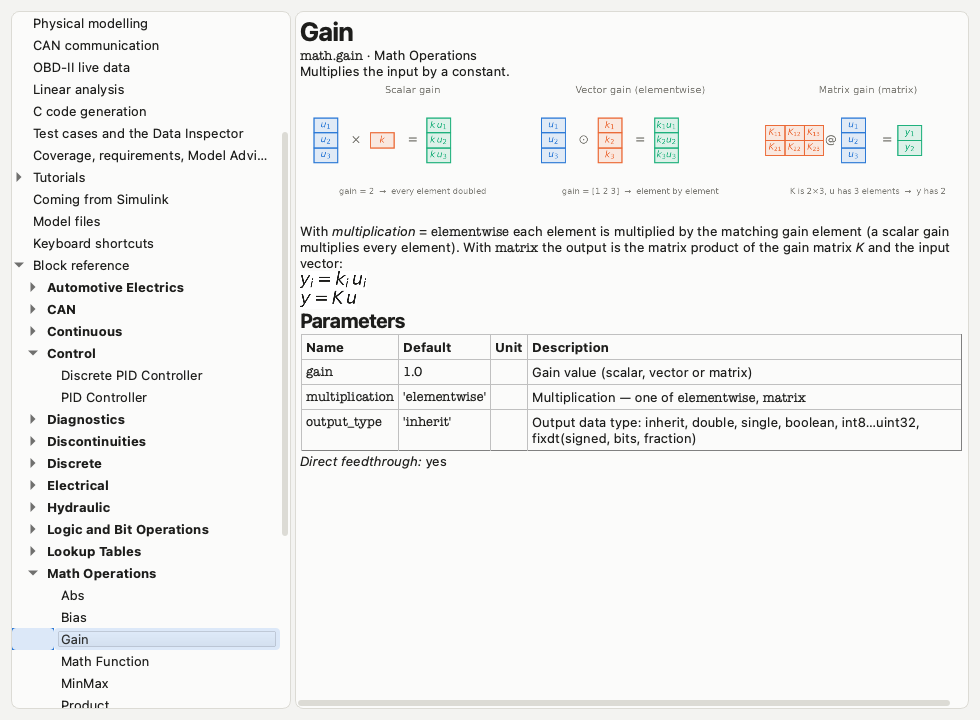

The in-app guide pages are also available here:
[Getting started](app-help/getting_started.md) ·
[Using the editor](app-help/editor.md) ·
[Running simulations](app-help/simulation.md) ·
[Workspace and calibrations](app-help/workspace.md) ·
[Keyboard shortcuts](app-help/shortcuts.md)


**Help ▸ About Nervus** shows the version and the versions of Python, Qt, NumPy and SciPy (**Copy for a bug
report** puts them on the clipboard for an issue on GitHub), the links to the documentation and the source, the
**contributors** with what each of them contributed, and the licence.

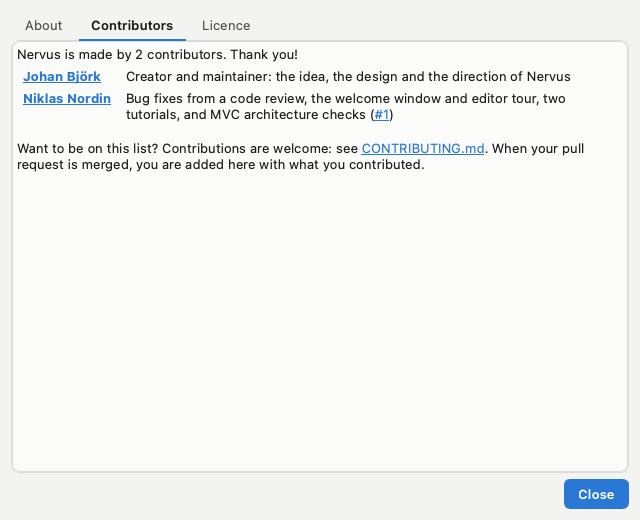
## Troubleshooting

**"Could not find the Qt platform plugin"** on macOS: some tools mark every file inside `.venv` as *hidden*,
and Qt skips hidden plugin files. Nervus clears that flag automatically when it starts. If you start Qt some
other way, run `chflags -R nohidden .venv`.
