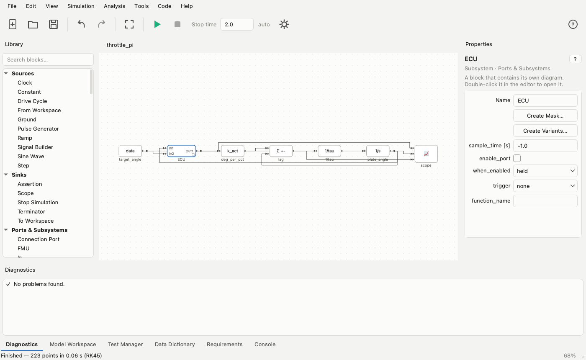
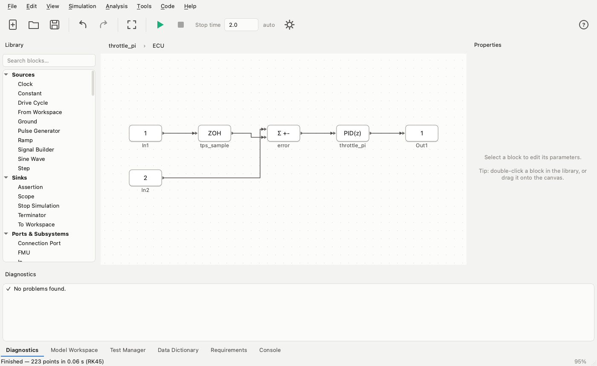
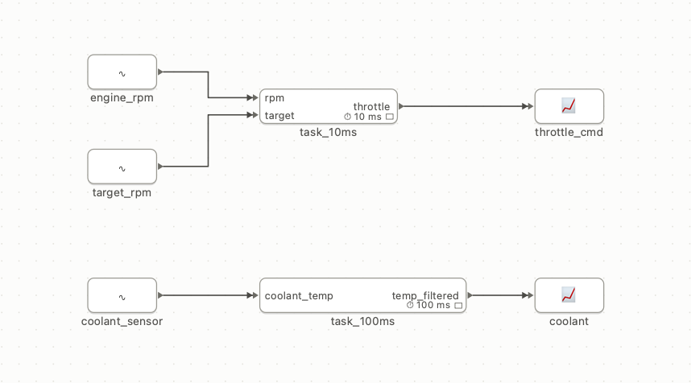
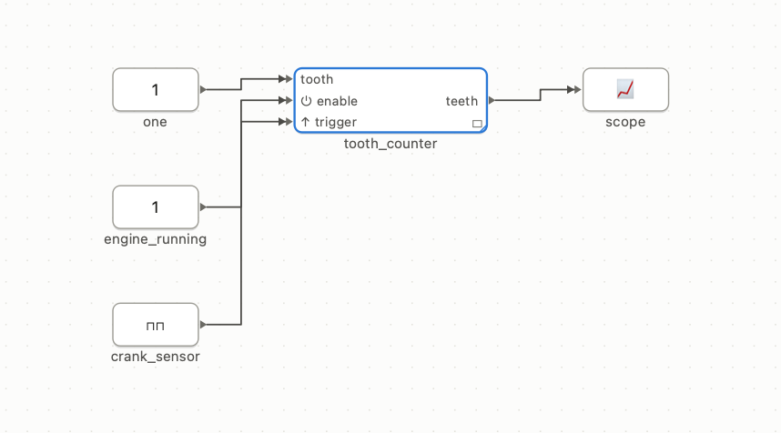
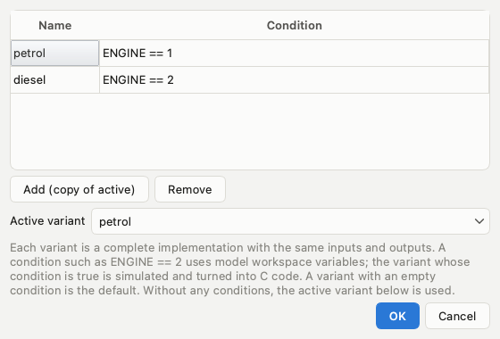
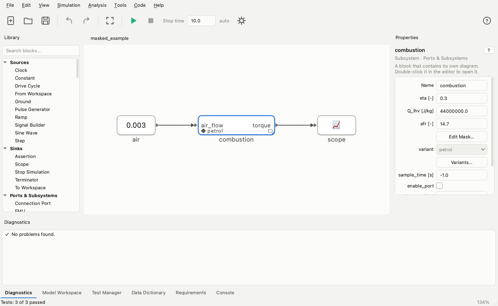
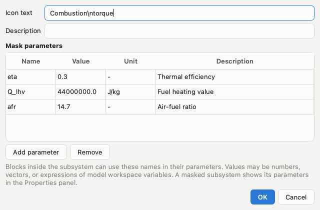
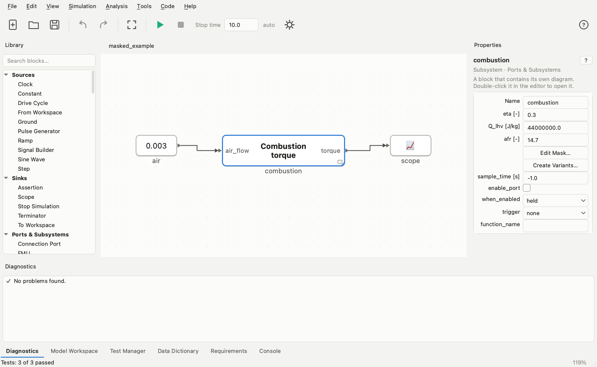

# Subsystems

A **subsystem** is a block that contains its own diagram. Subsystems structure a model the way functions
structure code. In ECU work, each subsystem is typically one software function (throttle control, fuel,
ignition), and the generated C code will follow that structure.

Here the throttle example is grouped so that everything running on the ECU (sensor sampling, error and
PI controller) is inside one subsystem:



Double-click it to open it. The breadcrumb bar shows the path back to the model:



## In the editor

| Action | How |
|---|---|
| Group blocks into a subsystem | select them, **Edit → Create Subsystem from Selection** (⌘G / Ctrl+G) |
| Open a subsystem | double-click it |
| Go back up | click a breadcrumb, or **View → Up to Parent** (⌘↑ / Ctrl+Up) |
| Add an empty subsystem | **Library → Ports & Subsystems → Subsystem** |

Lines crossing the selection boundary become **In**/**Out** ports. Undo works across levels and opens the
subsystem where the change is undone.

## Atomic subsystems: one ECU task

An ECU's operating system runs its software in **tasks** with fixed periods, such as a 10 ms task for idle
speed and throttle control and a 100 ms task for temperatures. In Nervus, a subsystem with a *sample_time*
is such a task:



- Every block inside that **inherits** its sample time (`-1`, e.g. Gain, Sum, Counter, Discrete PID with
  `sample_time = -1`) runs at the task period. Blocks with their own sample time keep it, and an inner task
  keeps its own period.
- The inputs are **sampled** at the start of each period and the outputs **held** until the next one, as if
  the task read its inputs from RAM when it starts.
- Blocks with continuous states (Integrator, Transfer Function) are not allowed inside. Use their discrete
  versions.
- The block shows its period (⏱ 10 ms). In generated C the multirate scheduler runs each task's blocks at
  its rate, or, with *one function per task*, each task becomes its own C function (see [C code generation](codegen.md)).

So you set the period in one place, and every block in the task follows it: change `sample_time` to
`"Ts_fast"` and the whole task moves with the workspace variable.

## Enabled subsystems

Tick *enable_port* in a subsystem's Properties to give it an extra last input, **⏻ enable**. While the
enable is ≤ 0 nothing inside runs: outputs and discrete states are held, and continuous states stop. Typical
use: a function that only runs in one operating mode, with the enable coming from a State Chart's mode output.

| *when_enabled* | Discrete states when enabled again |
|---|---|
| `held` (default) | continue from where they stopped |
| `reset` | restart from their initial values |

The enable is decided once per time step (when the blocks inside execute) and held during solver
sub-steps. The generated C wraps the subsystem's blocks in `if (enabled)` and resets their states the same
way, which the test suite checks against the simulation with zero tolerance.

## Triggered subsystems

Set *trigger* to `rising`, `falling` or `either` to give the subsystem a last input, **trigger**. The
subsystem then runs only when that signal has an edge, and holds its outputs and states in between. Use it
for event-driven functions: counting crank teeth, latching a value when a button is pressed, or running a
task each time a CAN message arrives.



| *trigger* | Runs when the trigger signal goes |
|---|---|
| `rising` | from ≤ 0 to > 0 |
| `falling` | from > 0 to ≤ 0 |
| `either` | either way |

The trigger is checked each time the blocks inside would execute, so drive it with a discrete signal of the
same rate as those blocks. The first execution only records the trigger value, so nothing runs before the
first real edge. Blocks with continuous states (integrators, transfer functions) are not allowed inside; use
their discrete versions. A subsystem can have both an enable and a trigger input (data inputs first, then
enable, then trigger). It then runs on an edge only while it is enabled. The generated C checks the edge the
same way, and the tests compare it with the simulation with zero tolerance.

## Variant subsystems: several implementations of one component

A subsystem can have **variants**: alternative implementations with the same inputs and outputs. Typical
uses: a petrol and a diesel engine model, a simple and a detailed sensor model, or the controller for two
vehicle versions. Only the active variant is simulated and turned into C code.

Select a subsystem and press **Create Variants…** (or **Variants…**) in the Properties panel:



- **Add (copy of active)** creates a new variant as a copy of the active one; open the subsystem and change it.
- **Condition** chooses the variant from model workspace variables, e.g. `ENGINE == 2`. Comparisons
  (`==`, `!=`/`~=`, `<`, `<=`, `>`, `>=`) and `and`/`&&`, `or`/`||`, `not`/`~` are allowed. A variant with an
  empty condition is the **default**, used when no condition is true. It is an error if several conditions
  are true at once.
- Without any conditions, you pick the **active variant** by hand.

The block shows the active variant (◆ petrol). Opening the subsystem shows and edits the active variant;
switch variants to edit another. A parameter sweep can switch variants too:
`simulate(model, 10, params={"ENGINE": 2})`.



```python
engine = Subsystem(system=petrol_engine)
engine.active_variant = "petrol"
engine.add_variant("diesel", diesel_engine, condition="ENGINE == 2")
engine.variants["petrol"].condition = "ENGINE == 1"
```

## Function-call subsystems

Sometimes logic, not a clock, decides when a function runs: store a value each time the engine is switched
off, or run a learning routine once per drive cycle. Set *trigger* to `function_call`: the subsystem then runs
**once every time the trigger value changes**. The caller, usually a State Chart, increments a counter output
whenever it wants the function to run:

```text
input u
output calls = 0

state low
state high
  entry: calls = calls + 1      # call the subsystem once, every time we enter "high"

transition low -> high: u > 0.5
transition high -> low: u < -0.5
```

Connect `calls` to the subsystem's trigger input (marked ƒ()). The subsystem runs in the same time step as the
call, after the chart, and holds its outputs and states between calls. In generated C it becomes
`if (call counter changed) { ... }` around its blocks.

## Masks: reusable components with parameters

A **masked** subsystem has its own parameters, like a function's arguments. The blocks inside use them in
their expressions, and each copy of the subsystem can have different values. This is how you build
reusable components such as an engine model with a `displacement` parameter.

Select a subsystem and press **Create Mask…** (or **Edit Mask…**) in the Properties panel:



- **Mask parameters**: name, value, unit and description. Values can be numbers, vectors, or expressions of
  model workspace variables (`3 * base`).
- **Icon text**: shown on the block; `\n` starts a new line.
- **Description**: shown in the Properties panel.

The parameters then appear in the Properties panel of the subsystem, like the parameters of any block:



Names are looked up from the inside out: a block sees the parameters of the nearest mask first, then those
of outer masks, then the model workspace. In generated C, mask parameters are per-instance values. Only bare
**model workspace** variables become shared calibration parameters.

```python
from nervus.core import Variable

engine = Subsystem(system=engine_diagram)
engine.mask.add(Variable("displacement", 1.6e-3, "Swept volume", "m³"))
engine.mask_icon = "Engine\\n1.6 l"
```

## In Python

```python
from nervus import Diagram, simulate
from nervus.blocks import Gain, Inport, Integrator, Outport, Scope, Step, Subsystem, Sum

plant = Diagram("plant")
u = plant.add(Inport(port=1), name="u")
e = plant.add(Sum(signs="+-"), name="e")
k = plant.add(Gain(gain="1/tau"), name="k")  # uses the model workspace
y = plant.add(Integrator(), name="y")
plant.connect(u, (e, 0))
plant.connect(y, (e, 1))
plant.chain(e, k, y, plant.add(Outport(port=1), name="y_out"))

model = Diagram("model")
model.workspace["tau"] = 0.5
sub = model.add(Subsystem(system=plant), name="plant")
model.chain(model.add(Step(time=0.0)), sub, model.add(Scope()))

res = simulate(model, 2.0)
res["plant/y"]  # blocks inside subsystems are named by path
```

## How it works

Before simulation, the compiler **flattens** the hierarchy. The In and Out blocks inside subsystems become
identity nodes, so sorting, signal widths and sample times work across subsystem boundaries exactly as in a
flat model. Every block keeps its path name for results and error messages.

In [model files](model-files.md), a subsystem block carries its diagram in a nested `"system"` entry (schema version 3).
