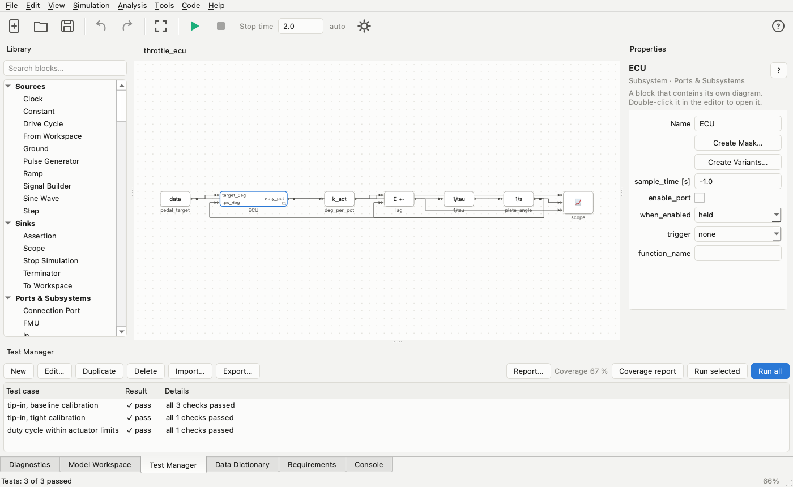
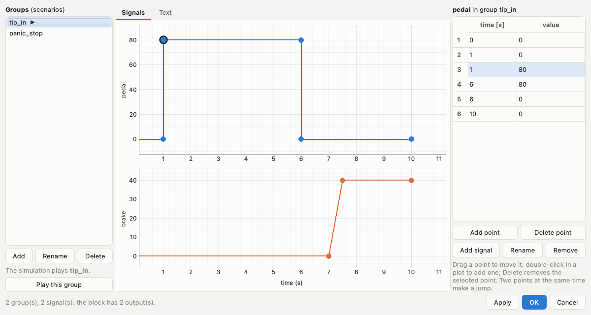
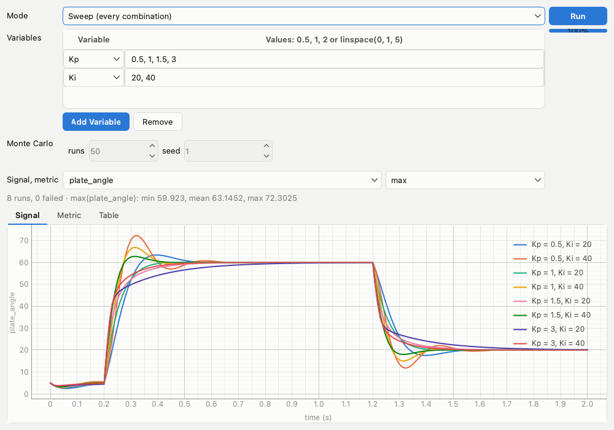
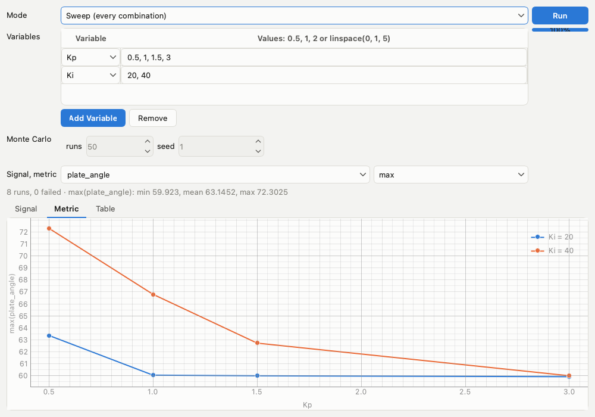
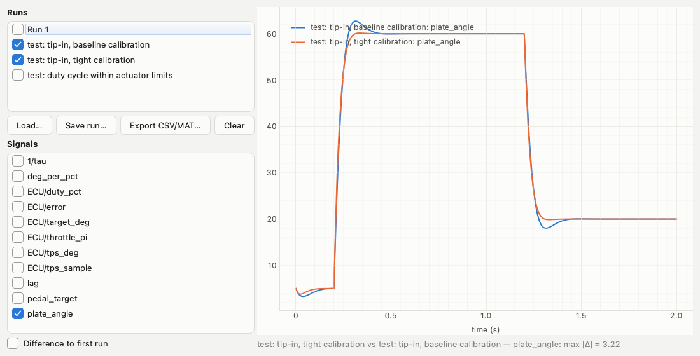

# Test cases, scenarios and results

Model-based development lives on **reproducible tests**: the same scenario, run after every change, with
clear pass/fail criteria. In Nervus a **test case** is saved with the model and contains:

- **inputs**: time signals for the model's top-level **In** blocks (the scenario),
- **parameters**: workspace overrides and/or a parameter-set file (the calibration under test),
- a **stop time**,
- **checks**: what must be true about the results.



## In the editor

Open the **Test Manager** tab (next to Diagnostics):

| Button | Does |
|---|---|
| New / Edit… | opens the test case editor: inputs, parameter overrides, parameter set, stop time, checks |
| Duplicate / Delete | as named; every change is undoable and saved with the model |
| Run selected / Run all | runs the tests in the background (**Simulation → Run All Tests**, ⌘T) |

The *Result* column shows ✓ pass / ✗ fail. *Details* names the failing check and why ("reached at
t = 0.41"). Double-click a result to open it in the **Data Inspector**.

### Inputs

In the test case editor, every top-level In block has a row. Enter points as `time: value` pairs:

```
0: 5, 0.2: 60, 1.2: 20
```

With *interpolation* `hold` this is a staircase (5 until 0.2 s, then 60, then 20); with `linear` it ramps
between the points. Vector inputs use `[ ]`: `0: [1 2], 1: [3 4]`. Leave a row empty to use the In block's
own *value*.

### Checks

| Check | Arguments | Passes when |
|---|---|---|
| `bounds` | `lower`, `upper`, optional `t_from`, `t_to` | the signal stays within [lower, upper] (in the time window) |
| `final_value` | `value`, `tolerance` | the last value is value ± tolerance |
| `reaches` | `value`, `before`, optional `direction=below` | the signal reaches the value before the given time |
| `max` / `min` | `value` | the maximum is at most / the minimum is at least the value |
| `baseline` | `path`, `tolerance` | the signal matches a saved result file within the tolerance (regression test) |

Signals are named as in results: `plate_angle`, `ECU/throttle_pi`, `mux:1`.

## Drawing test signals: the Signal Builder

For signals that are easier to draw than to type, put a **Signal Builder** block (Library → Sources) in the model
and double-click it:



- Each **signal** is a plot and one output of the block (*Add signal*, *Rename*, *Remove*). Drag a point to move it,
  double-click in a plot to add one, select a point and press **Delete** to remove it. The table on the right shows
  the selected signal's points exactly; type in it for precise values.
- Between two points the signal is a straight line. **Two points at the same time make a jump** (the pedal pressed
  in one instant); after the last point the value is held. The solver stops exactly at every point, so jumps are
  sharp.
- **Groups** are scenarios with the same signals: a tip-in, a panic stop, a cold start. **Add** copies the current
  group as a starting point. **Play this group** chooses the one the simulation uses (the block's *group*
  parameter, also in the Properties panel).
- The **Text** tab shows the same signals as text, e.g. `pedal: 0 0, 1 0, 1 80, 6 80` (pairs of time and value);
  **Apply** writes them to the block, as one step you can undo.

Test cases set the model's In blocks; a Signal Builder lives *inside* the model, so it suits scenarios you switch
by hand while you develop, and models without top-level inputs.

## Test suites as files

**Export…** in the Test Manager saves the selected test cases (or all of them) to a `.nervtest` file, and
**Import…** adds the test cases of such a file to the open model. Use it to share a test suite between
model variants, or to keep the tests of a component in its own file next to the library.

## Test report

After a test run, **Report…** saves a self-contained HTML page with every test case, its parameters and every
check with its result, plus the model coverage when it was measured. It works in light and dark mode and can
be attached to a review or archived with a release.

```python
from nervus.testing import load_suite, run_tests, save_html_report, save_suite

save_suite(model.tests, "throttle_tests.nervtest")
results = run_tests(model, load_suite("throttle_tests.nervtest"))
save_html_report(results, "report.html", "Throttle controller tests")
```

## Parameter sweeps and Monte Carlo runs

To see how a design behaves over a range of parameters, or with production tolerances, run it many times
from Python and collect a few numbers (metrics) per run:

```python
from nervus.sweep import monte_carlo, sweep

# Every combination: 3 × 2 = 6 runs.
table = sweep(
    model,
    {"Kp_stft": [0.05, 0.1, 0.2], "n_exh": [8, 20]},  # the lambda control example
    metrics={"lambda_min": lambda r: r["lambda_cyl"].min()},
)
print(table.summary())

# Tolerances: 100 runs with random parameters (normal, uniform or choice). Here, for the lambda control
# example: injectors that deliver up to a few percent more or less fuel than their nominal flow.
table = monte_carlo(
    model,
    {"injector_error": ("normal", 0.0, 0.02), "tau_sensor": ("uniform", 0.08, 0.12)},
    runs=100,
    metrics={"ltft_end": lambda r: r["ECU/ltft_pct"][-1]},
    seed=1,
)
table.to_csv("monte_carlo.csv")  # one row per run: parameters, metrics, error
lowest = table.column("ltft_end").min()
```

A metric is any function of the result that returns one number. Runs that fail (for example a parameter
value that makes the model invalid) are kept with their error message, so they show up in the table.

### In the editor

**Analysis → Parameter Sweep / Monte Carlo…** (Ctrl+Shift+W) does the same without code. Add the workspace
variables to vary and their values: a list (`0.5, 1, 1.5, 3`) or `linspace(0.5, 3, 6)` for a sweep over every
combination, or `normal(mean, std)` / `uniform(low, high)` with a number of runs and a seed for Monte Carlo.
Choose a signal (an Out block or any block) and a metric of it: final value, max, min, mean, RMS,
peak-to-peak or the time of the maximum. **Run** simulates in the background (the model is locked meanwhile;
**Stop** ends early) and shows:

- **Signal**: the signal of every run on top of each other; with many runs (Monte Carlo) in one transparent
  colour, so where the runs bunch up is darker;
- **Metric**: the metric against the first variable, one line per value of the second (sweep), or a
  histogram (Monte Carlo);
- **Table**: one row per run, with **Export CSV…**.





Ready-made metrics are also available in Python: `metric("plate_angle", "max")` from `nervus.sweep`.

## Data Inspector

**Simulation → Data Inspector** (⌘I) keeps the last 20 runs, both normal simulations and test results.
Check runs and signals to overlay them. With two runs selected it shows the largest difference, and
*Difference to first run* plots the deviation directly. *Save run…* writes a `.nervres` file (use it as a
baseline), *Load…* reads one (or an MDF4 measurement, or a [vehicle log](obd.md#logs-from-scanner-apps-and-can-loggers)), and *Export* writes CSV, MATLAB `.mat` or MDF4.



### MDF4 measurement files

**MDF4** (`.mf4`, ASAM MDF) is the file format of INCA, CANape, vehicle data loggers and test benches
(`uv sync --extra mdf`). *Load…* also reads MDF4 files, so a vehicle measurement can be overlaid on a
simulation, and *Export* writes a run as MDF4 to open it in the calibration tool. An MDF file keeps every
channel group at its own rate (a logger records each CAN message at its own period); on loading, all channels
are put on the time base of the group with the most samples, the others linearly interpolated. Text and
byte-array channels are skipped.

```python
from nervus.mdf import mdf_channels, read_mdf, write_mdf

mdf_channels("drive.mf4")  # {'n_engine': 'rpm', 'T_coolant': 'degC', ...}
rec = read_mdf("drive.mf4", ["n_engine", "T_coolant"], raster=0.01)
write_mdf(res, "simulation.mf4", units={"rpm": "rpm"})
```

A recorded channel can drive a model: `FromWorkspace(time=rec.t, data=rec["n_engine"])`, or an In block in a
test case.

## In Python

```python
from nervus import load, simulate
from nervus.core import Check, Signal, TestCase
from nervus.testing import compare_results, run_tests

model = load("examples/throttle_ecu.nervus")
for result in run_tests(model, base_dir="examples"):  # the tests stored in the model
    print(result.summary())

# A scenario for a top-level In block called "pedal":
res = simulate(model, inputs={"pedal": Signal.steps([(0, 5), (0.2, 60)])})

# Results
res.save("baseline.nervres")
res.to_mat("run.mat")  # for MATLAB users
old = type(res).load("baseline.nervres")
print(compare_results(res, old))  # max |difference| per signal

# A new test case
case = TestCase(
    "tip-in",
    parameter_set="throttle_tight.nervcal",
    checks=[Check("reaches", "plate_angle", {"value": 59.0, "before": 0.35})],
)
model.tests.append(case)
```

Because tests are plain Python objects, the same checks work inside **pytest**, which is how you run model
regression tests in CI. The Nervus repository does exactly that for the examples.

### Signals from logged data

`Signal.from_csv("drive_log.csv", "rpm")` reads a column of a CSV file (first column = time), for example
data exported from a vehicle logger, to replay a real drive as a test input. For scanner app logs and CAN logs
use [`read_log`](obd.md#logs-from-scanner-apps-and-can-loggers), for MDF4 files `read_mdf` (above).
